# 국방지능형플랫폼포털 화면 사용 설명서

**공식 포털명:** 국방지능형플랫폼포털 (K-Defense Intelligence Platform)  
**문서 버전:** 1.0  
**작성일:** 2026-07-05  
**대상 독자:** 포털 사용자, 프로젝트 책임자, 데이터/AI 운영자, 보안·시스템 관리자  

---

## 1. 개요

본 문서는 `docs/assets/final/`에 캡처된 18개 주요 화면을 대상으로, **사용자 지침 수준의 기능·절차·주의사항**을 정리한 것입니다.  
각 항목은 화면 캡처, 화면의 목적, 주요 UI 요소, 사용 절차, 관련 요구사항(SFR), 그리고 보안/운영상 주의사항으로 구성됩니다.

> **보안등급 표준:** 본 포털에서 사용하는 정보자산의 보안등급은 `공개 / 내부 / 비밀`로 통일합니다.  
> (예시: `공개` = public, `내부` = internal, `비밀` = secret)

---

## 2. 주요 화면 사용 지침

### 2.1 통합 대시보드 (01-portal-dashboard)

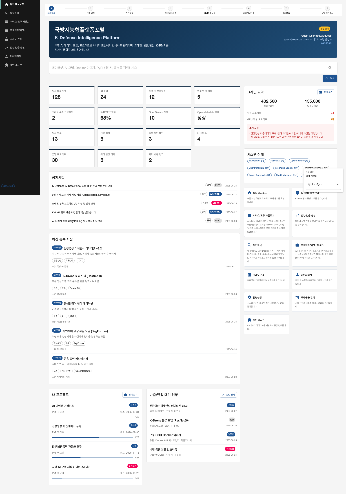

**목적**  
포털 전체의 현황을 한눈에 파악하는 메인 화면입니다. 데이터셋·AI 모델·프로젝트·반출/반입 승인, 크레딧, K-RMF 증빙 상태 등을 종합적으로 보여줍니다.

**주요 UI 요소**

- 상단 검색창: 데이터셋, AI 모델, Docker 이미지, PyPI 패키지, 문서 등을 통합 검색
- 요약 카드: 등록 데이터셋, AI 모델, 진행 중 프로젝트, 반출/반입 대기 건수 등
- K-RMF 증빙 진행률/시스템 상태: 보안 통제 이행 상태 및 연계 시스템(Backstage, Keycloak, OpenSearch 등) 상태
- 공지사항/최신 등록 자산/내 프로젝트/반출·반입 대기 현황

**사용 절차**

1. 로그인 후 포털 메인(통합 대시보드)으로 이동합니다.
2. 상단 검색창에서 원하는 자산을 검색하거나, 좌측 메뉴에서 세부 화면으로 이동합니다.
3. K-RMF 증빙 진행률이나 시스템 상태가 `경고/오류`로 표시되면 우측 상단의 알림 영역 또는 K-RMF 증빙관리 메뉴에서 상세 내역을 확인합니다.

**관련 SFR:** SFR-001, SFR-012  
**주의사항:** 대시보드 수치는 실시간 집계 기반이며, 보안등급에 따라 일부 위젯이 노출되지 않을 수 있습니다.

---

### 2.2 통합검색 (02-integrated-search)

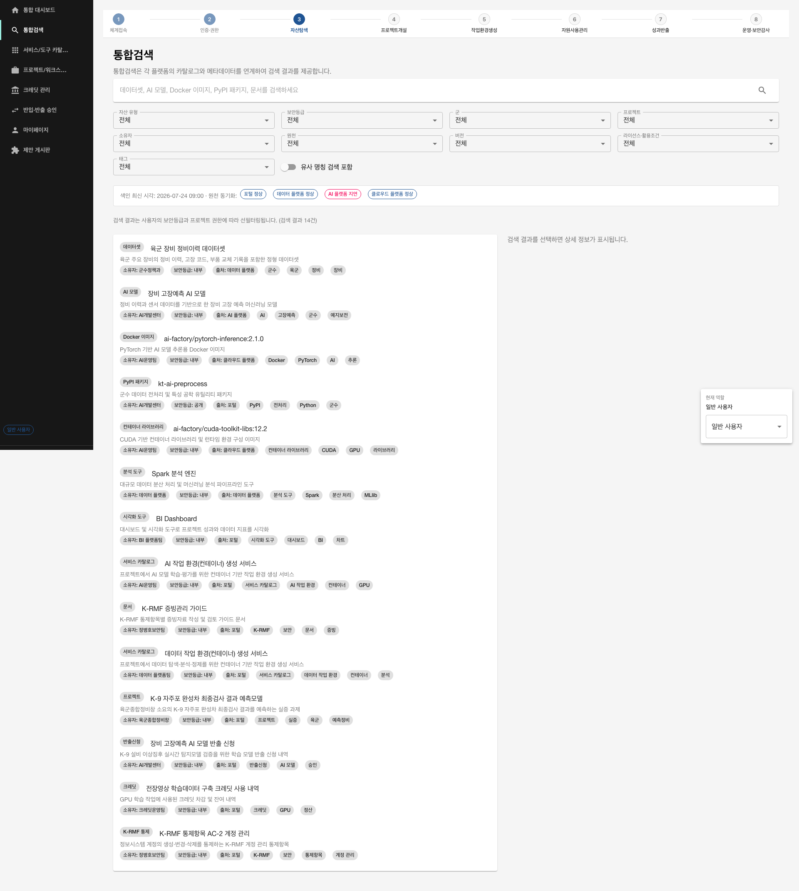

**목적**  
데이터셋, AI 모델, Docker 이미지, PyPI 패키지, 문서 등 다양한 자산을 한 번에 검색하고 필터링합니다.

**주요 UI 요소**

- 검색어 입력창
- 필터: 검색 대상 유형(전체/데이터셋/AI 모델/도커 이미지/PyPI 패키지/문서), 보안등급, 소스 시스템, 태그
- 검색 결과 목록: 자산명, 설명, 소유자, 보안등급, 출처, 태그

**사용 절차**

1. 검색어를 입력합니다.
2. 필요 시 상단 필터에서 `보안등급`, `소스 시스템`, `태그`를 선택해 결과를 좁힙니다.
3. 결과 항목을 클릭하면 상세 정보 페이지로 이동합니다.

**관련 SFR:** SFR-014, SFR-015  
**주의사항:** `비밀` 등급 자산은 검색 결과에서도 접근 권한이 없으면 상세 보기가 제한됩니다.

---

### 2.3 프로젝트/워크스페이스 (03-project-workspace)

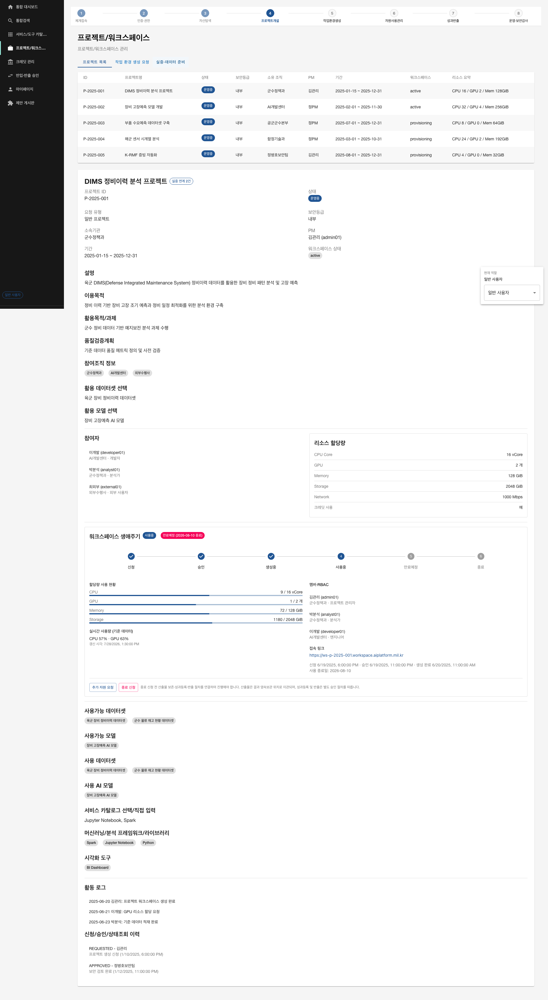

**목적**  
프로젝트 목록을 조회하고, 개별 프로젝트의 상세 정보, 참여자, 사용 데이터셋/AI 모델, 리소스 할당량, 활동 로그, 승인 이력을 관리합니다.

**주요 UI 요소**

- 프로젝트 목록 탭 / 프로젝트 생성 신청 탭
- 프로젝트 ID, 프로젝트명, 상태, 보안등급, 소유 조직, PM, 기간, 워크스페이스 상태, 리소스 요약
- 상세 영역: 설명, 목적, 참여자, 리소스 할당량, 사용 데이터셋, 사용 AI 모델, 활동 로그, 승인 이력

**사용 절차**

1. 좌측 메뉴 `프로젝트/워크스페이스`를 선택합니다.
2. 목록에서 프로젝트를 클릭하면 하단에 상세 정보가 펼쳐집니다.
3. 새 프로젝트가 필요하면 `프로젝트 생성 신청` 탭에서 정보를 입력해 신청합니다.
4. 리소스 할당량 변경이 필요하면 크레딧 관리 또는 관리자에게 추가 신청합니다.

**관련 SFR:** SFR-016, SFR-018  
**주의사항:** 프로젝트의 보안등급은 프로젝트 내 모든 자원의 최대 보안등급을 결정하므로 신중히 선택해야 합니다.

---

### 2.4 반입·반출 승인 (04-export-approval)

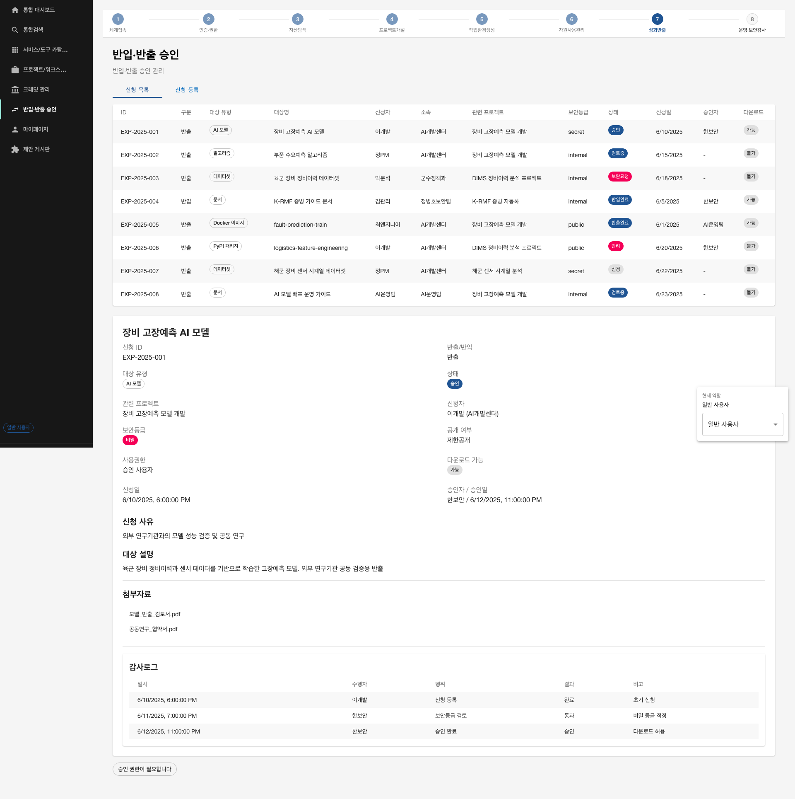

**목적**  
AI 모델, 데이터셋, Docker 이미지, PyPI 패키지, 문서 등의 반출/반입 신청을 등록하고, 승인 절차를 추적합니다.

**주요 UI 요소**

- 신청 목록 / 신청 등록 탭
- 목록 컬럼: ID, 구분(반출/반입), 대상 유형, 대상명, 신청자, 소속, 관련 프로젝트, 보안등급, 상태, 신청일, 승인자, 다운로드 가능 여부
- 상세 영역: 신청 ID, 대상 유형, 보안등급, 사용권한, 신청 사유, 대상 설명, 첨부자료, 감사로그

**사용 절차**

1. `반입·반출 승인` 메뉴로 이동합니다.
2. `신청 등록` 탭에서 구분, 대상 유형, 대상명, 보안등급, 사유, 첨부자료를 입력하고 저장합니다.
3. `신청 목록`에서 처리 상태를 확인하고, 승인 완료 시 다운로드 버튼 또는 반입 절차를 진행합니다.
4. 승인자는 목록에서 `검토중` 상태 항목을 선택해 승인/반려 처리합니다.

**관련 SFR:** SFR-009, SFR-010, SFR-011, SFR-012  
**주의사항:** `비밀` 등급 자산은 제한공개 또는 승인 사용자로 지정된 경우에만 다운로드할 수 있습니다. 외부 연구기관 공동 연구 시 반출 사유와 첨부자료를 반드시 기재합니다.

---

### 2.5 크레딧 관리 (05-credit-manager)

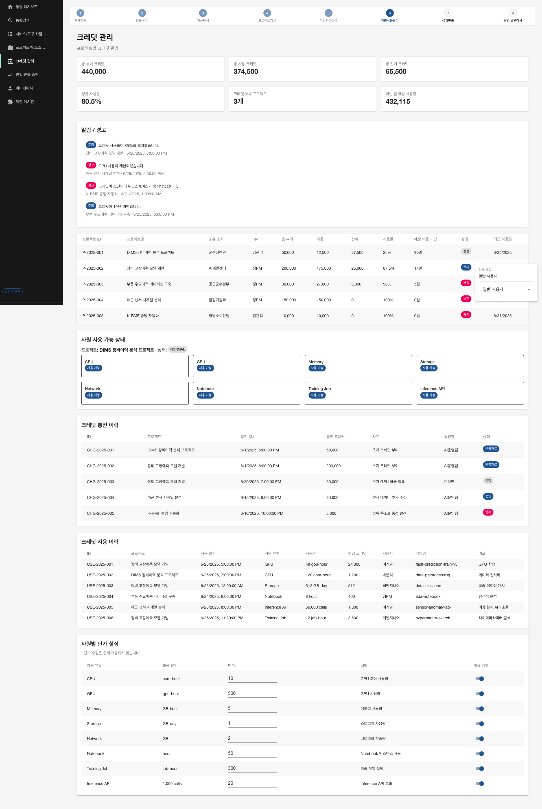

**목적**  
프로젝트별 GPU/CPU/메모리/스토리지 등 자원 사용에 따른 크레딧을 조회하고, 사용 이력과 자원별 단가를 관리합니다.

**주요 UI 요소**

- 요약 카드: 총 부여 크레딧, 총 사용 크레딧, 총 잔여 크레딧, 평균 사용률, 크레딧 부족 프로젝트, 이번 달 예상 사용량
- 알림/경고: 사용률 임계값 초과, GPU 사용 제한, 크레딧 소진 예정 등
- 프로젝트별 크레딧 현황 테이블
- 자원 사용 가능 상태, 크레딧 충전 이력, 크레딧 사용 이력
- 자원별 단가 설정

**사용 절차**

1. `크레딧 관리` 메뉴로 이동합니다.
2. 상단 요약 카드와 알림 영역에서 크레딧 부족/과다 사용 프로젝트를 확인합니다.
3. 프로젝트별 사용 현황 테이블에서 특정 프로젝트의 사용률과 잔여 크레딧을 점검합니다.
4. 크레딧 충전이 필요하면 관리자에게 충전 이력 기준으로 신청합니다.
5. 자원별 단가는 관리자 권한으로 수정할 수 있습니다.

**관련 SFR:** SFR-017, SFR-018  
**주의사항:** `내부`/`비밀` 프로젝트의 크레딧 사용은 감사로그에 남으며, 정책상 한도를 초과하면 자원 사용이 제한될 수 있습니다.

---

### 2.6 K-RMF 증빙관리 (06-krmf-evidence)

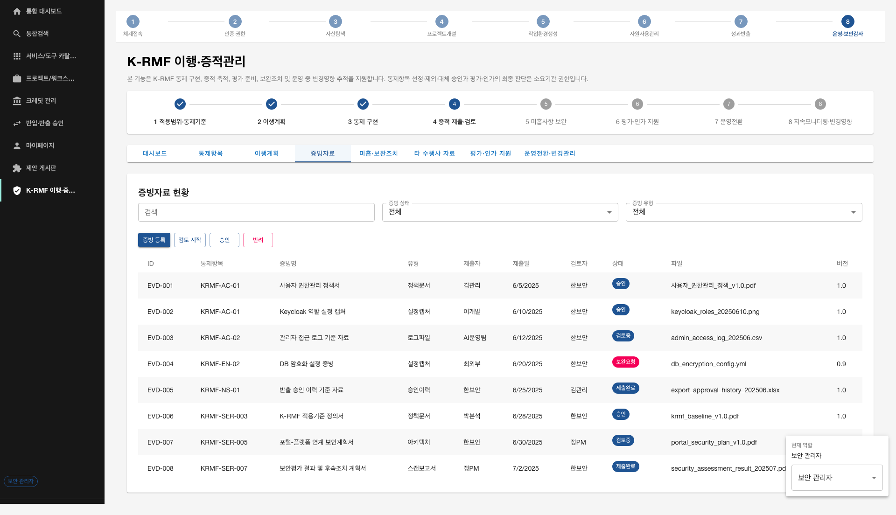

**목적**  
국방 정보통신망 보안통제 이행 현황(K-RMF)을 관리하고, 통제항목별 증빙 진척률과 미흡사항을 모니터링합니다.

**주요 UI 요소**

- 탭: 대시보드, 통제항목, 증빙자료, 미흡사항, 타 수행사 자료
- 요약 카드: 전체 통제항목, 적용 대상, 증빙 제출 완료, 증빙 승인 완료, 미흡사항, 보안 진행, 전체 진척률, 고위험 이슈
- 영역별 진척률: 접근통제, 계정관리, 로그관리, 암호화, 네트워크 보안, 취약점 관리, 데이터 보호, 백업/복구, 변경관리, 보안감사
- 최근 미흡사항

**사용 절차**

1. `K-RMF 증빙관리` 메뉴로 이동합니다.
2. `대시보드` 탭에서 전체 진척률과 고위험 이슈를 확인합니다.
3. 진척률이 낮은 영역을 클릭하거나 `통제항목` 탭으로 이동해 상세 통제를 확인합니다.
4. 증빙자료를 준비한 후 `증빙자료` 탭에서 업로드하고, `미흡사항` 탭에서 개선 계획을 등록합니다.

**관련 SFR:** SFR-004  
**주의사항:** K-RMF 증빙자료는 보안등급에 따라 접근 권한이 제한되며, 외부 유출 시 심각한 보안사고가 될 수 있습니다.

---

### 2.7 관리자 콘솔 - 사용자 관리 (07-admin-console-user-management)

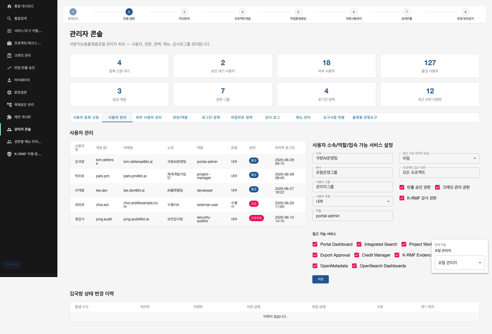

**목적**  
포털 사용자를 등록·관리하고, 사용자별 소속/역할/접속 가능 서비스/접근 가능 데이터 등급을 설정합니다.

**주요 UI 요소**

- 상단 요약: 등록 신청 대기, 승인 대기 사용자, 외부 사용자, 활성 사용자, 잠금 계정, 권한 그룹, 로그인 정책, 최근 보안 이벤트
- 사용자 관리 탭: 사용자명, 계정 ID, 이메일, 소속, 역할, 유형, 상태, 마지막 로그인
- 우측 설정 패널: 사용자 소속/역할/접속 가능 서비스, 접근 가능 데이터 등급, 프로젝트 접근 권한
- 하단 상태 변경 이력

**사용 절차**

1. `관리자 콘솔` → `사용자 관리`로 이동합니다.
2. 사용자 목록에서 대상을 선택하면 우측에 설정 패널이 표시됩니다.
3. 소속, 역할, 사용자 유형, 접속 가능 서비스, 접근 가능 데이터 등급을 설정한 후 `저장(MOCK)`을 클릭합니다.
4. 상태 변경 이력 탭에서 변경 내역을 추적합니다.

**관련 SFR:** SFR-002, SFR-003  
**주의사항:** `비밀` 데이터 접근 권한은 보안 관리자 승인을 받은 후에만 부여해야 합니다. 외부 사용자(external-user)의 접속 가능 서비스는 최소 권한 원칙에 따라 설정합니다.

---

### 2.8 관리자 콘솔 - 권한/RBAC 관리 (08-admin-console-rbac-menu)

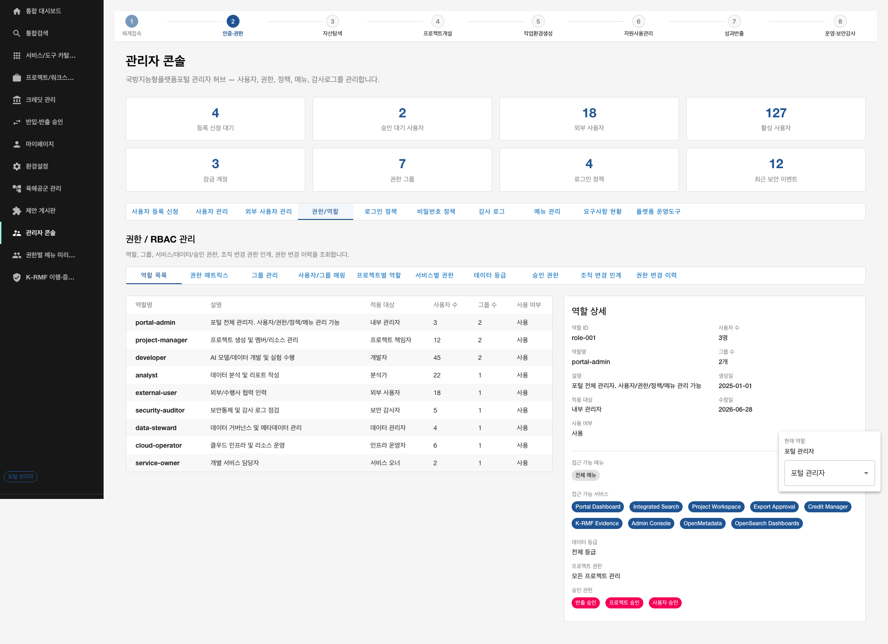

**목적**  
역할 기반 접근 제어(RBAC)를 정의하고, 역할별 메뉴/데이터/서비스/프로젝트/승인 권한을 관리합니다.

**주요 UI 요소**

- 역할 목록, 권한 매트릭스, 그룹 관리, 사용자/그룹 매핑, 프로젝트별 역할, 서비스별 권한, 데이터 등급, 승인 권한, 조직 변경 인계, 권한 변경 이력
- 역할 상세: 역할 ID, 역할명, 설명, 적용 대상, 사용자 수, 그룹 수, 사용 여부, 접근 가능 메뉴/서비스, 데이터 등급, 프로젝트 권한, 승인 권한

**사용 절차**

1. `관리자 콘솔` → `권한/역할`로 이동합니다.
2. `역할 목록`에서 역할을 선택해 우측 상세 권한을 확인합니다.
3. 새 역할이 필요하면 역할 추가 후 메뉴·데이터·서비스·승인 권한을 설정합니다.
4. `사용자/그룹 매핑` 탭에서 역할과 사용자/그룹을 연결합니다.
5. `권한 변경 이력`에서 모든 변경 내역을 감사합니다.

**관련 SFR:** SFR-005  
**주의사항:** `portal-admin` 역할은 포털 전체 관리 권한을 가지므로, 역할 부여는 보안 담당자의 승인이 필요합니다.

---

### 2.9 관리자 콘솔 - 정책/감사 로그 (09-admin-console-policy-audit)

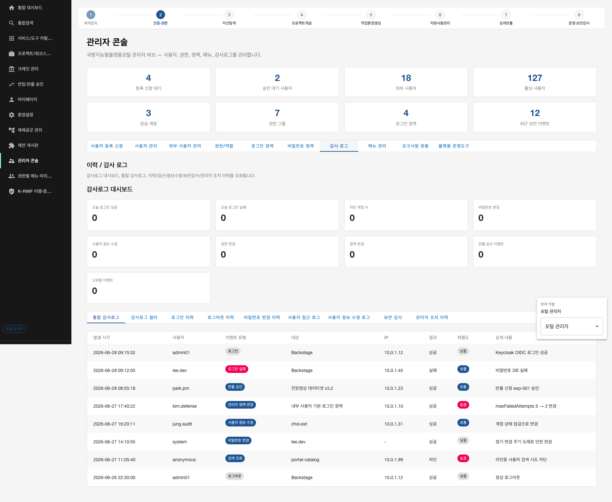

**목적**  
로그인, 로그아웃, 비밀번호 변경, 사용자 접근, 권한 변경, 반출 승인, 관리자 조치 등 모든 보안 이벤트를 조회하고 위험도를 평가합니다.

**주요 UI 요소**

- 감사로그 대시보드: 오늘 로그인 성공/실패, 차단 계정 수, 비밀번호 변경, 사용자 정보 수정, 권한 변경, 정책 변경, 반출 승인 이벤트, 고위험 이벤트
- 하위 탭: 통합 감사로그, 감사로그 필터, 로그인 이력, 로그아웃 이력, 비밀번호 변경 이력, 사용자 접근 로그, 사용자 정보 수정 로그, 보안 감사, 관리자 조치 이력
- 이력 테이블: 발생 시각, 사용자, 이벤트 유형, 대상, IP, 결과, 위험도, 상세 내용

**사용 절차**

1. `관리자 콘솔` → `감사 로그`로 이동합니다.
2. 대시보드에서 금일 주요 이벤트 지표를 확인합니다.
3. `통합 감사로그`에서 검색/필터로 특정 사용자·이벤트·위험도를 조회합니다.
4. 고위험 이벤트(예: 미인증 사용자 검색 시도 차단, 비밀번호 반복 실패)는 즉시 보안 담당자에게 보고합니다.

**관련 SFR:** SFR-002, SFR-004  
**주의사항:** 감사로그는 법적·규제적 증거자료로 활용될 수 있으므로 임의 수정·삭제가 불가능합니다.

---

### 2.10 Backstage 로그인 선택 (09-backstage-signin)

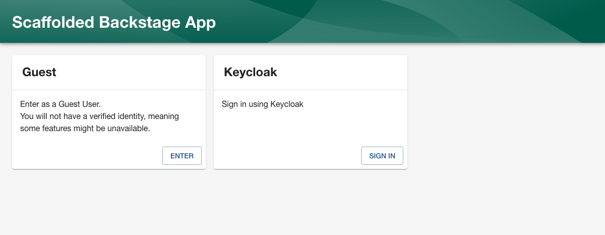

**목적**  
Backstage 기반 포털에 접근할 인증 방식을 선택합니다.

**주요 UI 요소**

- Guest: 게스트 사용자로 입장(검증된 신원 없이 일부 기능 제한)
- Keycloak: Keycloak OIDC 연동을 통한 공식 인증

**사용 절차**

1. 포털 URL(`http://localhost:3000` 또는 배포된 도메인)에 접속합니다.
2. 내부 사용자는 `Keycloak`의 `SIGN IN` 버튼을 클릭합니다.
3. Keycloak 로그인 페이지에서 계정을 인증합니다.
4. 테스트·익명 탐색이 필요한 경우에만 `Guest`의 `ENTER`를 사용합니다.

**관련 SFR:** SFR-002  
**주의사항:** Guest 로그인은 신원 검증이 없어 민감 데이터 접근이 제한됩니다. 업무용도로는 Keycloak 인증을 사용해야 합니다.

---

### 2.11 Keycloak 로그인/로그아웃 (09-keycloak-login)

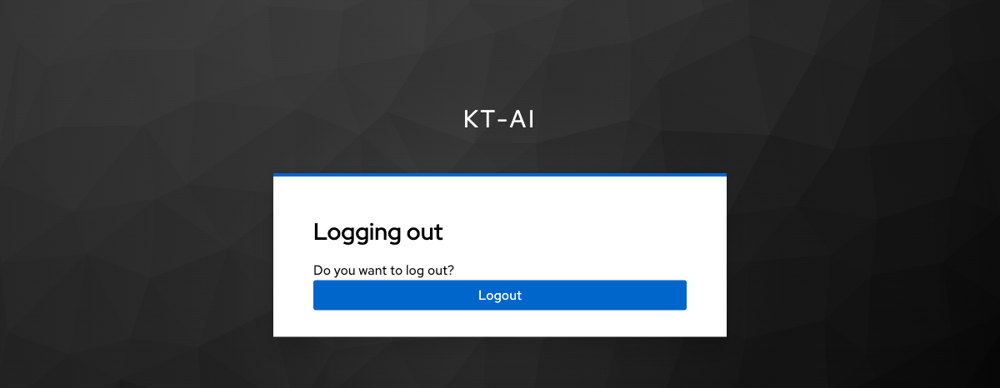

**목적**  
Keycloak 인증 서버를 통해 사용자를 인증하고, 로그아웃을 처리합니다.

**주요 UI 요소**

- 로그인 화면: 사용자명/비밀번호 입력
- 로그아웃 확인 화면: `Logout` 버튼

**사용 절차**

1. Backstage 로그인 선택 화면에서 Keycloak 인증을 선택합니다.
2. Keycloak 로그인 페이지에서 계정 ID와 비밀번호를 입력합니다.
3. 인증 성공 시 포털 메인으로 이동합니다.
4. 로그아웃 시 우측 상단 사용자 메뉴에서 로그아웃을 선택하고, Keycloak 로그아웃 확인 화면에서 `Logout`을 클릭합니다.

**관련 SFR:** SFR-002  
**주의사항:** 타인의 계정을 사용하지 않으며, 공용 PC에서 사용 후 반드시 로그아웃합니다.

---

### 2.12 서비스/도구 카탈로그 (10-service-catalog)

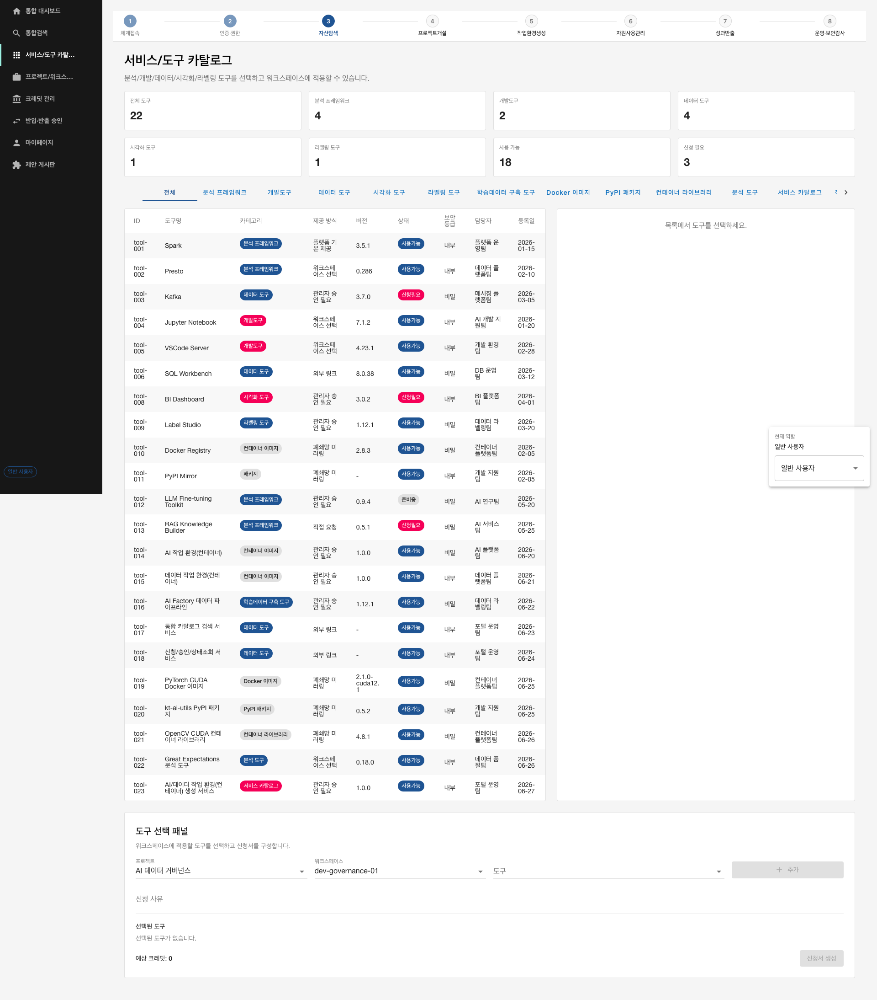

**목적**  
분석 프레임워크, 개발도구, 데이터 도구, 시각화 도구, 라벨링 도구 등 AI/데이터 작업에 필요한 도구를 조회하고 워크스페이스에 신청/적용합니다.

**주요 UI 요소**

- 요약 카드: 전체 도구, 분석 프레임워크, 개발도구, 데이터 도구, 시각화 도구, 라벨링 도구, 사용 가능, 신청 필요
- 카테고리 탭: 전체, 분석 프레임워크, 개발도구, 데이터 도구, 시각화 도구, 라벨링 도구, 직접 입력 요청, 요구사항 대응 현황
- 도구 목록: ID, 도구명, 카테고리, 제공 방식, 버전, 상태, 보안등급, 담당자, 등록일
- 도구 선택 패널: 프로젝트/워크스페이스 선택, 도구 선택, 신청 사유, 예상 크레딧

**사용 절차**

1. `서비스/도구 카탈로그` 메뉴로 이동합니다.
2. 카테고리 탭이나 검색으로 필요한 도구를 찾습니다.
3. 도구를 선택하면 우측에 상세 정보가 표시됩니다.
4. 하단 `도구 선택 패널`에서 프로젝트/워크스페이스와 도구를 선택하고 신청 사유를 작성한 뒤 `신청서 생성(MOCK)`을 클릭합니다.

**관련 SFR:** SFR-007, SFR-008, SFR-014  
**주의사항:** `관리자 승인 필요` 상태의 도구는 승인 완료 후 사용할 수 있습니다. 도구의 보안등급이 프로젝트 보안등급보다 높으면 신청할 수 없습니다.

---

### 2.13 제안 게시판 (11-proposal-board)

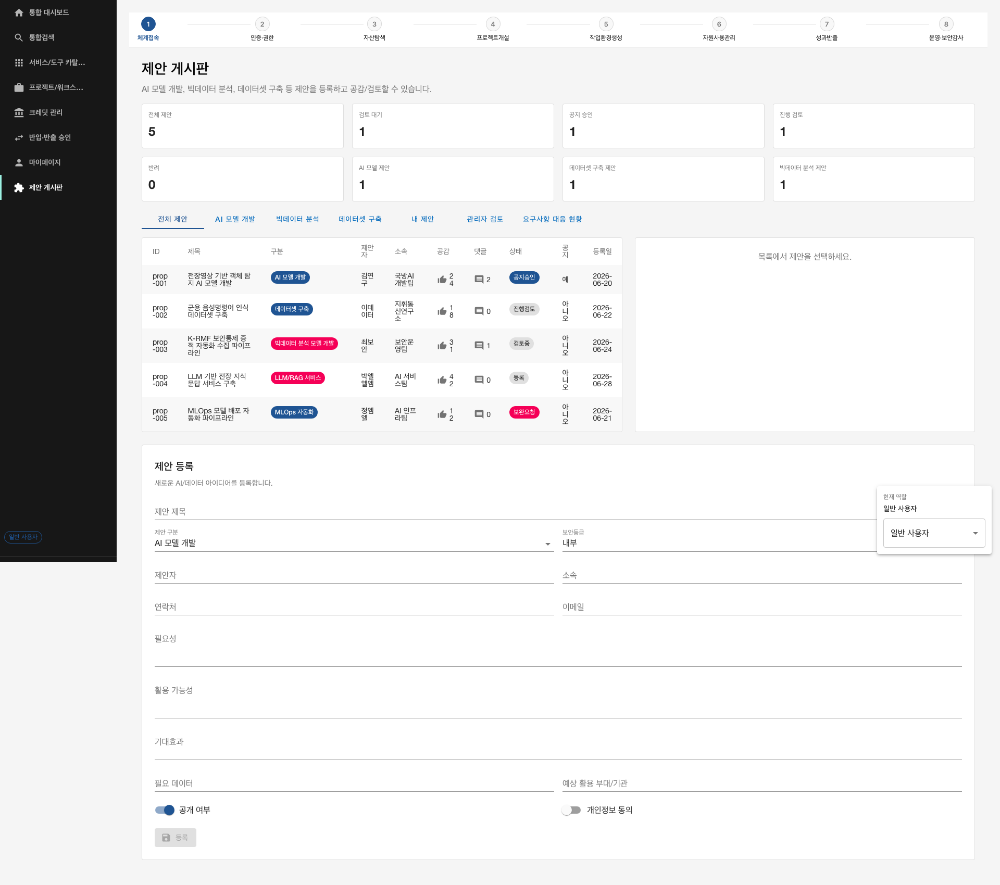

**목적**  
AI 모델 개발, 빅데이터 분석, 데이터셋 구축 등 아이디어를 등록하고 공감/검토/요구사항 대응 현황을 관리합니다.

**주요 UI 요소**

- 요약 카드: 전체 제안, 검토 대기, 공지 승인, 진행 검토, 반려, AI 모델 제안, 데이터셋 구축 제안, 빅데이터 분석 제안
- 카테고리 탭: 전체 제안, AI 모델 개발, 빅데이터 분석, 데이터셋 구축, 내 제안, 관리자 검토, 요구사항 대응 현황
- 제안 목록: ID, 제목, 구분, 제안자, 소속, 공감/댓글, 상태, 공지 여부, 등록일
- 제안 등록 폼: 제안 제목, 구분, 보안등급, 제안자, 소속, 연락처, 이메일, 필요성, 활용 가능성, 기대효과, 필요 데이터, 공개 여부, 개인정보 동의

**사용 절차**

1. `제안 게시판` 메뉴로 이동합니다.
2. 기존 제안을 조회하고 공감·댓글을 남깁니다.
3. 새 제안 등록 시 하단 폼에 필요 항목을 입력하고 `제안 저장(MOCK)`을 클릭합니다.
4. 관리자는 `관리자 검토` 탭에서 제안을 검토·승인·반려 처리합니다.

**관련 SFR:** SFR-013  
**주의사항:** 제안 내용에 개인정보가 포함되지 않도록 주의하며, `비밀` 제안은 승인된 관계자만 열람할 수 있습니다.

---

### 2.14 마이페이지 (12-my-page)

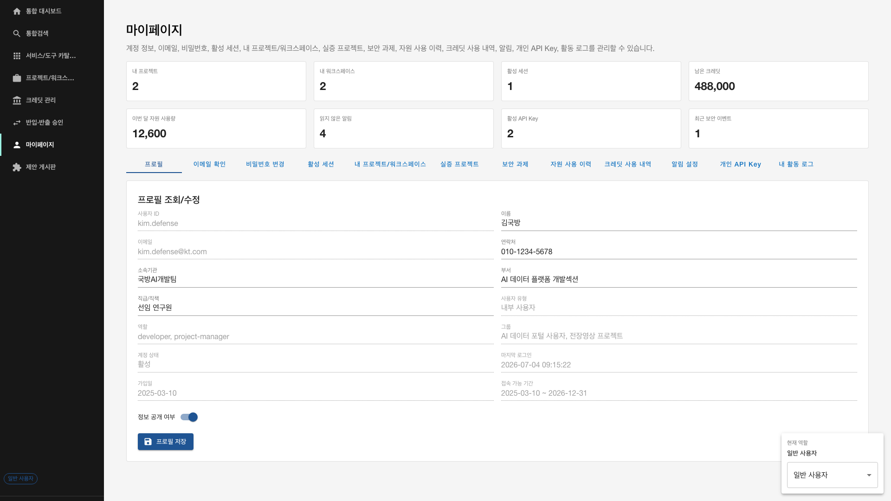

**목적**  
개인 계정, 세션, 프로젝트, 자원, 알림, API Key, 활동 이력을 조회하고 프로필 정보를 수정합니다.

**주요 UI 요소**

- 요약 카드: 내 프로젝트, 내 워크스페이스, 활성 세션, 남은 크레딧, 이번 달 자원 사용량, 읽지 않은 알림, 활성 API Key, 최근 보안 이벤트
- 탭: 프로필, 이메일 확인, 비밀번호 변경, 활성 세션, 내 프로젝트/워크스페이스, 자원 사용 이력, 크레딧 사용 내역, 알림 설정, 개인 API Key, 내 활동 로그, 요구사항 대응 현황
- 프로필 조회/수정: 사용자 ID, 이름, 이메일, 연락처, 소속기관, 직급/직책, 사용자 유형, 역할, 그룹, 계정 상태, 가입일, 접속 가능 기간, 정보 공개 여부

**사용 절차**

1. 우측 상단 사용자 메뉴에서 `마이페이지`를 선택합니다.
2. `프로필` 탭에서 개인 정보를 확인하고 필요 시 수정합니다.
3. `비밀번호 변경`, `활성 세션`, `알림 설정` 탭에서 보안·수신 설정을 관리합니다.
4. `개인 API Key` 탭에서 외부 API 연동용 키를 발급·폐기합니다.

**관련 SFR:** SFR-019  
**주의사항:** API Key는 외부에 노출되지 않도록 안전하게 보관하며, 유출 의심 시 즉시 폐기하고 재발급합니다.

---

### 2.15 환경설정 (13-environment-settings)

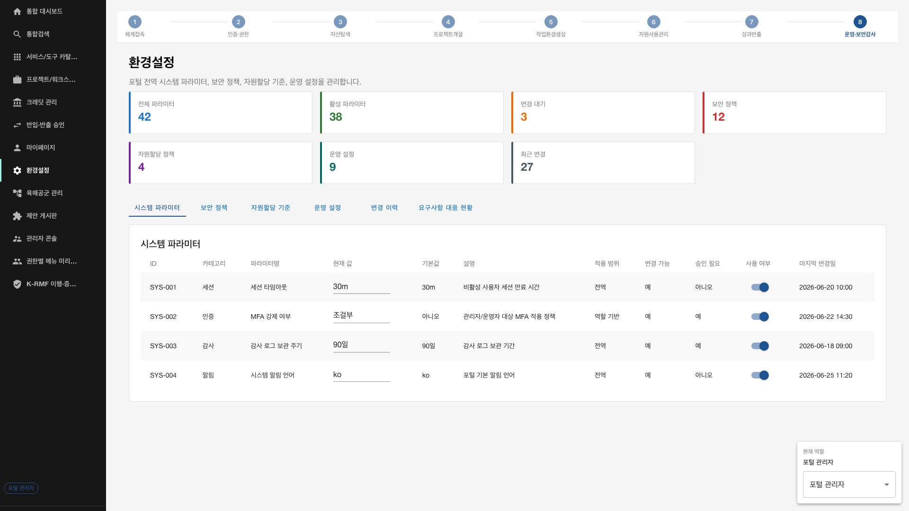

**목적**  
포털 전역 시스템 파라미터, 보안 정책, 자원할당 기준, 운영 설정을 관리합니다.

**주요 UI 요소**

- 요약 카드: 전체 파라미터, 활성 파라미터, 변경 대기, 보안 정책, 자원할당 정책, 운영 설정, 최근 변경
- 탭: 시스템 파라미터, 보안 정책, 자원할당 기준, 운영 설정, 변경 이력, 요구사항 대응 현황
- 시스템 파라미터 테이블: ID, 카테고리, 파라미터명, 현재 값, 기본값, 설명, 적용 범위, 변경 가능 여부, 승인 필요 여부, 사용 여부, 마지막 변경일

**사용 절차**

1. `환경설정` 메뉴로 이동합니다.
2. `시스템 파라미터` 탭에서 세션 타임아웃, MFA 강제 여부, 감사 로그 보관 주기, 시스템 언어 등을 확인합니다.
3. 변경이 필요한 파라미터의 값을 수정하고, 승인이 필요한 경우 관리자 승인을 요청합니다.
4. `변경 이력` 탭에서 수정 내역을 확인합니다.

**관련 SFR:** SFR-020  
**주의사항:** 보안 정책(MFA 강제, 세션 타임아웃, 감사 로그 보관 기간) 변경은 보안 담당자와 협의 후 시행합니다.

---

### 2.16 육해공군 관리자 권한 및 멀티테넌트 관리 (14-tenant-management)

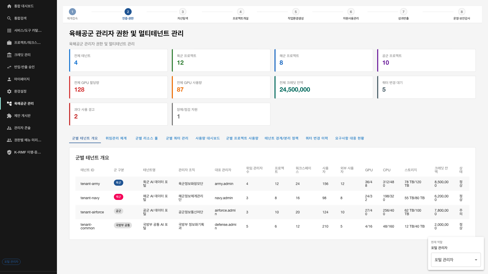

**목적**  
육군·해군·공군·국방부 공통 등 군별 테넌트를 구분하고, 테넌트별 관리자 권한, 리소스 풀, 쿼터, 프로젝트 사용량을 관리합니다.

**주요 UI 요소**

- 요약 카드: 전체 테넌트, 육군/해군/공군 프로젝트, 전체 GPU 할당량/사용량, 전체 크레딧 잔액, 쿼터 변경 대기, 과다 사용 경고, 장애/점검 자원
- 탭: 군별 테넌트 개요, 위임관리 체계, 군별 리소스 풀, 군별 쿼터 관리, 사용량 대시보드, 군별 프로젝트 사용량, 테넌트 경계/분리 정책, 쿼터 변경 이력, 요구사항 대응 현황
- 군별 테넌트 개요 테이블: 테넌트 ID, 군 구분, 테넌트명, 관리자 조직, 대표 관리자, 위임 관리자 수, 프로젝트 수, 워크스페이스, 사용자, 외부 사용자, GPU/CPU/스토리지, 크레딧 잔액, 상태

**사용 절차**

1. `육해공군 관리` 메뉴로 이동합니다.
2. `군별 테넌트 개요`에서 각 군 테넌트의 리소스 사용량과 상태를 확인합니다.
3. `국방부 공통` 테넌트는 공용 AI 포털 리소스로, 공동 사용 정책을 확인합니다.
4. 쿼터 변경이 필요하면 `군별 쿼터 관리` 탭에서 신청하고 이력을 추적합니다.

**관련 SFR:** SFR-021  
**주의사항:** 테넌트 간 데이터는 논리적으로 분리되어 있으며, 테넌트 경계를 넘는 접근은 엄격히 통제됩니다.

---

### 2.17 OpenMetadata 데이터 카탈로그 (15-openmetadata-catalog)

**목적**  
OpenMetadata와 연동하여 데이터 자산의 메타데이터, 소유자, 품질, 계보(Lineage)를 중앙에서 관리합니다.

**주요 UI 요소**

- OpenMetadata 로그인 화면(운영 환경에서는 SSO 연동)
- 데이터 인사이트: Total Data Assets, Description Coverage, Ownership Coverage 등 데이터 건강도 지표
- 데이터 자산 탐색, 앱 분석, 비용 분석

**사용 절차**

1. 포털 내 `OpenMetadata` 메뉴 또는 외부 링크를 클릭합니다.
2. OpenMetadata에 로그인합니다.
3. 데이터 자산을 검색하거나 `Data Insights`에서 품질/소유권 커버리지를 확인합니다.
4. 데이터셋 상세 페이지에서 설명, 태그, 보안등급, 계보를 관리합니다.

**관련 SFR:** SFR-014  
**주의사항:** OpenMetadata의 보안등급은 포털의 `공개/내부/비밀` 정책과 연동되어야 하며, 권한 없는 자산은 접근할 수 없습니다.

---

### 2.18 OpenSearch 대시보드 (16-opensearch-catalog-index)

**목적**  
OpenSearch에 수집된 로그·메트릭·검색 인덱스를 시각화하고 모니터링합니다.

**주요 UI 요소**

- OpenSearch Dashboards 진입 화면
- 인덱스 관리, 검색, 시각화(Visualization), 대시보드, 알림

**사용 절차**

1. 포털 내 `OpenSearch 대시보드` 메뉴 또는 외부 링크를 클릭합니다.
2. OpenSearch Dashboards에 로그인합니다.
3. `Discover`에서 인덱스를 선택하고 검색 쿼리로 로그를 조회합니다.
4. 사전 구성된 대시보드에서 시스템·보안·사용자 행태 메트릭을 모니터링합니다.

**관련 SFR:** SFR-001, SFR-015  
**주의사항:** 민감 로그(비밀 등급)는 OpenSearch 접근 권한이 별도로 제어되며, 외부 반출 시 보안 정책에 따라 승인이 필요합니다.

---

## 3. 보안등급 및 접근 제어 지침

| 보안등급 | 표시 | 접근 원칙 |
|---|---|---|
| 공개 | `public` | 모든 인증 사용자 접근 가능(일부 게스트 제외) |
| 내부 | `internal` | 소속 조직/프로젝트 내 사용자 접근 가능 |
| 비밀 | `secret` | 명시적 승인 또는 역할 기반 접근 필요, 반출 시 승인 필수 |

- 자산의 보안등급은 등록 시 설정하며, 이후 변경 시 변경 이력이 감사로그에 남습니다.
- `비밀` 자산은 검색 결과 목록에 노출되더라도 상세 보기·다운로드는 권한이 있는 사용자만 가능합니다.
- 외부 사용자(external-user)는 `내부` 이상 자산에 접근할 수 없으며, `공개` 자산만 조회 가능합니다.

---

## 4. 주요 화면 ↔ SFR 매핑 요약

| 화면 | 관련 SFR | 핵심 내용 |
|---|---|---|
| 통합 대시보드 | SFR-001, SFR-012 | 포털 메인, 플랫폼 연동 현황 |
| 통합검색 | SFR-014, SFR-015 | 카탈로그 조회, 통합검색 |
| 프로젝트/워크스페이스 | SFR-016, SFR-018 | 프로젝트 관리, 워크스페이스 관리 요청 |
| 반입·반출 승인 | SFR-009~SFR-012 | 반출입서버/AI 성과/데이터 분석 성과 관리 |
| 크레딧 관리 | SFR-017, SFR-018 | 크레딧 신청·조회, 자원 사용량 관리 |
| K-RMF 증빙관리 | SFR-004 | 정책·이력·증빙자료 관리 |
| 관리자 콘솔 - 사용자 관리 | SFR-002, SFR-003 | 로그인/로그아웃, 사용자 관리 |
| 관리자 콘솔 - 권한/RBAC | SFR-005 | 권한 관리 |
| 관리자 콘솔 - 정책/감사 로그 | SFR-002, SFR-004 | 정책 및 이력 관리 |
| Backstage 로그인 / Keycloak | SFR-002 | 메인 포털 로그인/로그아웃 |
| 서비스/도구 카탈로그 | SFR-007, SFR-008, SFR-014 | AI/데이터 작업 환경 생성 요청, 카탈로그 조회 |
| 제안 게시판 | SFR-013 | 제안게시판 |
| 마이페이지 | SFR-019 | 마이페이지 |
| 환경설정 | SFR-020 | 환경설정 |
| 육해공군 관리 | SFR-021 | 육해공군 관리자 권한 관리 |
| OpenMetadata / OpenSearch | SFR-001, SFR-014, SFR-015 | 데이터 카탈로그, 통합검색, 모니터링 |

---

## 5. 참고사항

- 본 문서의 화면 캡처는 개발·PoC 환경(`mock data` 기반)에서 촬영된 것으로, 실제 운영 환경의 데이터와는 다를 수 있습니다.
- 화면 내 `(MOCK)` 표시가 있는 버튼은 현재 데모/시연용으로 동작하며, 실제 외부 시스템 연동(Keycloak Admin API, Kubernetes, OpenStack, CMP, DB 등)은 추가 인프라 구성 후 활성화됩니다.
- 보안등급 표준 `공개 / 내부 / 비밀`은 23.6 Hotfix에서 확정되었으며, 모든 화면과 문서에 동일하게 적용됩니다.

---

*끝.*
