# ERD — 국방지능형플랫폼 포털 업무 스키마(portal, fc_ 접두)

> 기준: `backstage-portal/packages/backend/migrations/portal/`의 migration 9개 전체 적용 상태.
> **기관 표준사전(표준단어·용어·도메인·코드)은 아직 수령하지 못했으므로**, 본 문서의 한글 엔티티·컬럼 명칭은
> 전부 프로젝트 임시 정의(매핑상태 `임시정의`)이며, 실제 ERD는 물리 모델(migration 기준)이다.
> 모든 시각은 UTC `timestamptz`, 금액/수량은 `numeric(20,4)`이다.

## 1. 테이블 목록 (48개)

### 사용자·소속·역할 (init, org_group_delegation, tenant_settings, platform_access)

| 테이블 | 한글명(임시) | 생성 migration |
|---|---|---|
| fc_tenants | 테넌트 | 20260915000001_init |
| fc_organizations | 조직 | 20260915000001_init |
| fc_users | 사용자 | 20260915000001_init |
| fc_external_identities | 외부신원 | 20260915000001_init |
| fc_tenant_memberships | 테넌트소속 | 20260915000001_init |
| fc_roles | 역할 | 20260915000001_init |
| fc_permissions | 권한 | 20260915000001_init |
| fc_role_permissions | 역할권한매핑 | 20260915000001_init |
| fc_role_assignments | 역할부여 | 20260915000001_init |
| fc_groups | 그룹 | 20260916000001_org_group_delegation |
| fc_group_memberships | 그룹소속 | 20260916000001_org_group_delegation |
| fc_delegations | 위임 | 20260916000001_org_group_delegation |
| fc_membership_changes | 소속변경이력 | 20260916000001_org_group_delegation |
| fc_tenant_settings | 테넌트설정 | 20260918000001_tenant_settings |
| fc_platform_access | 플랫폼접근정책 | 20260924000001_platform_access |
| fc_portal_preferences | 포털개인설정 | 20260924000001_platform_access |

### 감사·비동기·멱등 (init, audit_append_policy)

| 테이블 | 한글명(임시) | 생성 migration |
|---|---|---|
| fc_audit_events | 감사이벤트 (원장, UPDATE/DELETE 금지) | 20260915000001_init |
| fc_outbox_events | 아웃박스이벤트 | 20260915000001_init |
| fc_idempotency_keys | 멱등키 | 20260915000001_init |

- 20260916000003_audit_append_policy는 테이블을 만들지 않고 `fc_audit_events`에 INSERT 전용 RLS 정책(`fc_audit_events_append`)을 추가한다.

### 프로젝트·업무신청 (work_requests, domains)

| 테이블 | 한글명(임시) | 생성 migration |
|---|---|---|
| fc_projects | 프로젝트(업무신청) | 20260924000002_work_requests |
| fc_project_members | 프로젝트멤버(업무신청) | 20260924000002_work_requests |
| fc_work_requests | 업무신청 (공통 신청 원장) | 20260924000002_work_requests |
| fc_request_events | 신청이벤트 | 20260924000002_work_requests |
| fc_project | 프로젝트 (4상태 생명주기) | 20260929000020_domains |
| fc_project_member | 프로젝트멤버 | 20260929000020_domains |
| fc_project_invite | 프로젝트초대 | 20260929000020_domains |

### K-RMF 평가 (krmf)

| 테이블 | 한글명(임시) | 생성 migration |
|---|---|---|
| fc_krmf_baseline | K-RMF기준선 | 20260929000001_krmf |
| fc_krmf_control | K-RMF통제 | 20260929000001_krmf |
| fc_krmf_evidence | K-RMF증적 | 20260929000001_krmf |
| fc_krmf_file | K-RMF파일 | 20260929000001_krmf |
| fc_krmf_action | K-RMF조치 | 20260929000001_krmf |
| fc_krmf_change | K-RMF변경 | 20260929000001_krmf |
| fc_krmf_trr_check | K-RMF시험준비항목 | 20260929000001_krmf |
| fc_krmf_eval_record | K-RMF평가기록 | 20260929000001_krmf |
| fc_krmf_control_link | K-RMF통제연결 | 20260929000001_krmf |

### 크레딧·반입반출 (domain_ledger)

| 테이블 | 한글명(임시) | 생성 migration |
|---|---|---|
| fc_credit_product | 크레딧상품 | 20260929000010_domain_ledger |
| fc_credit_account | 크레딧계정 | 20260929000010_domain_ledger |
| fc_credit_transaction | 크레딧거래 | 20260929000010_domain_ledger |
| fc_credit_request | 크레딧신청 | 20260929000010_domain_ledger |
| fc_transfer_request | 반입반출신청 | 20260929000010_domain_ledger |
| fc_transfer_file | 반입반출파일 | 20260929000010_domain_ledger |

### 제안·카탈로그·공통설정 (domains)

| 테이블 | 한글명(임시) | 생성 migration |
|---|---|---|
| fc_proposal | 제안 | 20260929000020_domains |
| fc_proposal_sympathy | 제안공감 | 20260929000020_domains |
| fc_proposal_review | 제안검토 | 20260929000020_domains |
| fc_catalog_item | 카탈로그항목 | 20260929000020_domains |
| fc_catalog_application | 카탈로그신청 | 20260929000020_domains |
| fc_portal_setting | 포털공통설정 | 20260929000020_domains |
| fc_portal_setting_history | 포털공통설정이력 | 20260929000020_domains |

## 2. 핵심 관계 (FK 기준)

- 전역 신원: `fc_users(user_id)` — 모든 사용자 참조 컬럼의 최종 부모. `fc_users`는 tenant 무관(전역).
- 테넌트 격리: tenant 범위 테이블은 `tenant_id NOT NULL` + `(tenant_id, id)` 복합 PK(또는 복합 FK)를 사용하고
  RLS(`portal.tenant_id` 설정 기반, 미설정 시 default deny)로 격리한다.
- 소속 경유 참조: tenant 낮 사용자·조직·그룹 참조는 `fc_tenant_memberships(tenant_id, id)` 복합 FK로만 허용한다.
- K-RMF 계층: 기준선(1) → 통제(N) → 증적(N) / 조치(N) / 통제연결(N), 증적(1) → 파일(N).
- 반입반출: 신청(1) → 파일(N), 승인 시 승인 파일 버전을 신청에 고정(`approved_file_version`).
- 크레딧: 계정(1) → 거래(N), 거래는 부호 규칙 CHECK(`grant/charge` 양수, `deduct` 음수).
- 업무신청: `fc_work_requests`가 공통 신청 원장이고, 카탈로그 신청은 `fc_catalog_application.work_request_id`로 **논리 참조**(FK 없음).

### 외부 원천 식별자(논리 참조, FK 없음)

| 출발 | 도착 | 비고 |
|---|---|---|
| fc_catalog_application.work_request_id | fc_work_requests.id | 도메인 상세 신청은 공통 신청 원장과 논리 연결 |
| fc_krmf_evidence.file_id | fc_krmf_file.id | 순환 참조 방지로 FK 없음(증적 → 파일 단방향 FK만 존재) |
| fc_transfer_request.approved_file_version | fc_transfer_file.version | 승인 버전 고정(신청 → 파일 복합 참조 의미) |
| fc_krmf_control_link.ref_id | 외부 시스템(요구사항/구현/시험/결함 ID) | 외부 원천 식별자 — 포털 낮에 대상 테이블 없음 |
| fc_credit_transaction.ref_type/ref_id | 외부 원천(승인 문서 등) | 문자열 다형 참조 |
| fc_audit_events.issuer/subject | fc_external_identities (issuer, subject) | 감사 기록 시점의 신원 스냅샷(FK 없음) |

## 3. 관계 다이어그램 (mermaid)

```mermaid
erDiagram
    fc_tenants ||--o{ fc_organizations : "tenant_id"
    fc_tenants ||--o| fc_tenants : "parent_id"
    fc_tenants ||--o{ fc_tenant_memberships : "tenant_id"
    fc_tenants ||--|| fc_tenant_settings : "tenant_id(PK)"
    fc_tenants ||--|| fc_platform_access : "tenant_id(PK)"
    fc_tenants ||--o{ fc_portal_preferences : "tenant_id"
    fc_users ||--o{ fc_external_identities : "user_id"
    fc_users ||--o{ fc_tenant_memberships : "user_id"
    fc_users ||--o{ fc_portal_preferences : "user_id"
    fc_organizations ||--o{ fc_organizations : "tenant_id+parent_id"
    fc_tenant_memberships ||--o{ fc_role_assignments : "tenant_id+membership_id"
    fc_tenant_memberships ||--o{ fc_group_memberships : "tenant_id+membership_id"
    fc_tenant_memberships ||--o{ fc_delegations : "tenant_id+delegator/delegatee"
    fc_tenant_memberships ||--o{ fc_membership_changes : "tenant_id+membership_id"
    fc_roles ||--o{ fc_role_permissions : "role_id"
    fc_permissions ||--o{ fc_role_permissions : "permission_id"
    fc_roles ||--o{ fc_role_assignments : "role_id"
    fc_roles ||--o{ fc_delegations : "role_id"
    fc_groups ||--o{ fc_groups : "tenant_id+parent_id"
    fc_groups ||--o{ fc_group_memberships : "tenant_id+group_id"
    fc_projects ||--o{ fc_project_members : "project_id"
    fc_users ||--o{ fc_projects : "owner_user_id"
    fc_work_requests ||--o{ fc_request_events : "request_id"
    fc_projects ||--o{ fc_work_requests : "project_id(nullable)"
    fc_users ||--o{ fc_work_requests : "requester/decided_by"
    fc_project ||--o{ fc_project_member : "project_id"
    fc_project ||--o{ fc_project_invite : "project_id"
    fc_proposal ||--o{ fc_proposal_sympathy : "proposal_id"
    fc_proposal ||--o{ fc_proposal_review : "proposal_id"
    fc_catalog_item ||--o{ fc_catalog_application : "item_id"
    fc_krmf_baseline ||--o{ fc_krmf_control : "baseline_id"
    fc_projects ||--o{ fc_krmf_baseline : "project_id(nullable)"
    fc_krmf_control ||--o{ fc_krmf_evidence : "control_id"
    fc_krmf_control ||--o{ fc_krmf_action : "control_id"
    fc_krmf_control ||--o{ fc_krmf_control_link : "control_id"
    fc_krmf_evidence ||--o{ fc_krmf_file : "evidence_id"
    fc_projects ||--o{ fc_krmf_change : "project_id(nullable)"
    fc_projects ||--o{ fc_krmf_trr_check : "project_id"
    fc_projects ||--o{ fc_krmf_eval_record : "project_id(nullable)"
    fc_credit_account ||--o{ fc_credit_transaction : "tenant_id+account_id"
    fc_users ||--o{ fc_credit_product : "created_by/updated_by"
    fc_users ||--o{ fc_credit_transaction : "created_by"
    fc_users ||--o{ fc_credit_request : "requested_by/decided_by"
    fc_transfer_request ||--o{ fc_transfer_file : "tenant_id+request_id"
    fc_users ||--o{ fc_transfer_request : "requested_by/decided_by"
    fc_users ||--o{ fc_transfer_file : "created_by"
```

### 참고

- 위 다이어그램은 대표 관계만 표시한다. 전체 컬럼·FK·CHECK 목록은 `DATA_DICTIONARY.csv`가 정본이다.
- `fc_users`를 참조하는 컬럼(승인자·생성자·수정자 등)은 tenant 경계를 넘지 않는 전역 신원 참조다.
- tenant 경계 낮 참조(조직·소속·그룹)는 복합 FK `(tenant_id, id)`로만 허용해 테넌트 간 참조를 차단한다.
- `fc_projects`(업무신청)와 `fc_project`(도메인)는 별개 테이블이다(이름 유사 주의).
