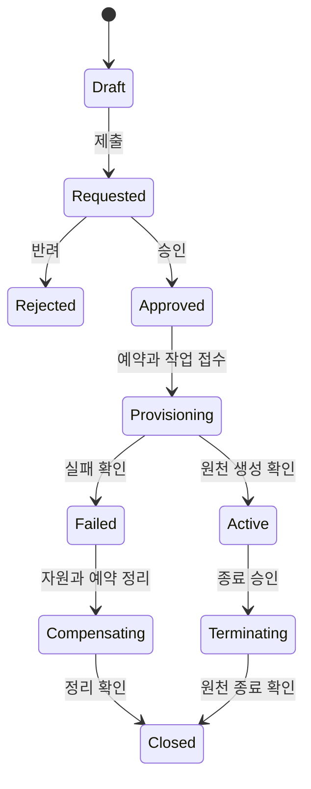

# 국방지능형플랫폼 포털 — 구현 계약 및 자체시험 기준

2026-09-15 · `KAIPotal_Kimi_Development_Prompt.md`의 필수 부속 사양

아래 테이블·경로·값은 **신규 구현의 설계 계약**입니다. 현재 구현되어 있거나 외부 플랫폼이 제공한다고 주장하는 명세가 아닙니다. Kimi는 현재 소스와 확정된 원천 API를 대조하여 구현하고, 변경이 필요한 계약은 이유와 migration을 기록해야 합니다.

## 1. 원천 책임과 데이터 상태

| 데이터 | 권위 있는 원천 | 포털 저장/표시 |
|---|---|---|
| 로그인 신원·비밀번호·MFA·IdP 세션 | Keycloak, 개발 프로파일은 검증된 Firebase adapter | issuer/subject 매핑·앱 접근승인·membership, 비밀번호 복제 금지 |
| tenant·포털 역할·메뉴·브랜드·개인 설정 | 포털 PostgreSQL | 버전된 정책과 실제 유효 설정 |
| 포털 업무 프로젝트·신청·승인 | 포털 PostgreSQL | workflow와 원천 프로젝트/환경 ID 연결 |
| CPU/GPU·실제 자원·사용량·프로비저닝 | CMP/AI/Data 플랫폼 | canonical projection, 원천 버전·동기화시각·operation |
| 크레딧 사용량·단가 | 확정 계약에서 정한 원천 | 포털 원장과 원천 event ID로 대사, 이중 과금 주체 금지 |
| 데이터 카탈로그·품질·계보 | OpenMetadata/데이터 플랫폼 | 허용된 metadata projection·버전 |
| 모델·이미지·패키지·도구 | AI/Artifact Registry/카탈로그 원천 | 유형별 schema·라이선스·버전·권한 |
| 검색 | 위 원천 데이터의 OpenSearch projection | 원본을 대체하지 않으며 ACL/최신성 검증 필수 |
| 증빙 파일 | 승인된 파일저장소 | metadata/hash/version/접근권한/검토 이력 |
| 감사 사실 | 서버 감사 원장과 IdP/원천 검증 이벤트 | 중앙 검색·별도 보존 사본, source/event ID로 구분 |
| K-RMF 적용·인가 결정 | 승인된 기준판·지정된 결정권자 | 근거·문서·판정·시각을 기록, 자동 적합 선언 금지 |

API의 `dataMode=live|synthetic`는 데이터 출처 기준이며, `connectionState=connected|unconfigured|degraded|unavailable`, `freshness=fresh|stale|unknown`와 별도 필드다. `live`는 실제 업무/원천 데이터를 뜻하며 최신성을 보장하지 않는다. 합성 DB 통합시험은 실제 DB·API를 사용하더라도 `synthetic`이다. 하나의 응답에 출처가 섞이면 항목별 dataMode를 제공한다.

원천 미연결 때 `null/—`와 상태를 표시하며 `0`으로 채우지 않는다. 실제 0건, 권한 없음, 연결 실패, 필터 결과 없음의 구분을 유지한다. 보안상 존재 여부를 숨겨야 하는 객체는 일관된 404 정책을 사용할 수 있다.

## 2. DB 구조 — 최소 도메인 범위

DB/스키마 명은 환경별로 설정하되 포털 업무, framework, Keycloak, 감사 접근권한을 구분한다. 새 업무 테이블 `fc_` 규칙을 적용한다. 테이블 정규화/병합은 가능하지만 아래 기능·제약·추적성은 보존한다.

| 도메인 | 제안 테이블 | 핵심 필드/제약 |
|---|---|---|
| tenant | `fc_tenants`, `fc_organizations` | code/name/branch/status/parent, hierarchy cycle 방지 |
| 사용자 | `fc_users`, `fc_external_identities` | 내부 user ID, `(issuer,subject)` unique, verified identity. email을 영구 식별자로 사용하지 않음 |
| 소속 | `fc_tenant_memberships`, `fc_project_memberships` | tenant/user/project, 상태·기간·승인자·종료일, 중복 active membership 제약 |
| 역할 | `fc_roles`, `fc_permissions`, `fc_role_permissions`, `fc_role_assignments` | system/tenant/project scope, effective interval, 위임자·사유·policy version |
| 조직·위임 | `fc_groups`, `fc_group_memberships`, `fc_delegations`, `fc_membership_changes` | 그룹 CRUD·tenant scope, 중첩 허용 여부/순환 방지, 변경 전후 scope·기간·승인·권한 회수 추적 |
| 브랜드 | `fc_tenant_theme_versions` | tenant/version/status/draft JSON/createdBy/publishedAt, 한 개 active version |
| 메뉴 | `fc_menu_definitions`, `fc_tenant_menu_versions` | routeRegistry ID/parent/order/visible/featureEnabled/권한 참조. 임의 executable 값 없음 |
| 개인화 | `fc_user_preferences`, `fc_saved_views`, `fc_favorites` | `(tenant,user,namespace)` unique, schemaVersion/version/config JSON, 권한 재검증 |
| 홈 | `fc_dashboard_templates` | tenant/version/widgetRegistry IDs/layout/config, min/max 위치 검증 |
| 정책 | `fc_policy_versions`, `fc_policy_applications` | 정책 종류/범위/버전/시행일/승인/IdP 반영 상태·결과 |
| 설정 | `fc_settings`, `fc_setting_changes` | typed value, scope, secretRef, validation schema, version/rollback |
| 프로젝트 | `fc_projects` | tenant/owner/name/purpose/status/start/end/source mappings/version |
| 환경 | `fc_workspaces`, `fc_workspace_requests` | project/template/version/resources/period/state/sourceId/operationId |
| 자원 | `fc_quota_allocations`, `fc_quota_reservations` | scope/resource/unit/limit/reserved/expiry; 예약·해제 원자성 |
| 승인 | `fc_approval_requests`, `fc_approval_steps`, `fc_approval_decisions` | workflowVersion/targetVersion/status/assignee/action/reason, 최종결정 중복 제약 |
| 연계작업 | `fc_operations`, `fc_idempotency_keys` | tenant/action/key/payloadHash/state/result/expiry, 동일 key 다른 payload 거부 |
| 비동기 | `fc_outbox_events`, `fc_job_attempts`, `fc_inbox_events` | eventId/dedupe/sourceEventId/leaseUntil/claimedBy/retryAt/status; 중복 수신 방지 |
| 비용·크레딧 | `fc_credit_accounts`, `fc_credit_entries`, `fc_price_versions`, `fc_usage_events` | decimal/minor-unit, 단가 버전·원천 event unique·reversal 참조. 원장 수정 금지 |
| 자산 | `fc_asset_projections`, `fc_asset_versions`, `fc_asset_grants` | tenant/source/sourceId/version/type/owner/classification/ACLVersion, source 기준 unique |
| 수집 | `fc_connectors`, `fc_sync_checkpoints`, `fc_sync_runs` | endpoint allowlist/secretRef/capabilities/version/watermark/lastSuccess/error |
| 검색인가 | `fc_search_policy_epochs` | tenant/partition authoritative ACL epoch, indexed epoch, stale barrier |
| 파일 | `fc_files`, `fc_file_versions`, `fc_file_scan_results` | tenant/objectKey/hash/size/contentType/scanState/source/version/retention |
| 반입·반출 | `fc_transfer_requests`, `fc_transfer_attempts` | asset/file version·approval ID·source/target·state·receipt·checksum |
| 알림 | `fc_notifications`, `fc_notification_receipts` | tenant/recipient/event/dedupe/channel/delivery/read/ack/expiry |
| 게시/지원 | `fc_posts`, `fc_post_revisions`, `fc_comments`, `fc_announcements` | tenant·작성/수정 권한, 상태/첨부/기간, escaping·정화 |
| API Key | `fc_api_credentials` | prefix/hash/user/service principal/scope/tenant/expiry/revokedAt/lastUsedAt; 원문 저장 금지 |
| K-RMF 기준 | `fc_control_catalogs`, `fc_controls`, `fc_control_applicability` | internalId/officialId/catalogVersion/sourceRef/sourcePage/approvedBy/applicability |
| K-RMF 실행 | `fc_implementation_plans`, `fc_evidence_records`, `fc_evidence_reviews`, `fc_findings` | control/version/owner/dueDate/fileVersion/review/verdict/followup |
| 평가·변경 | `fc_external_submissions`, `fc_assessments`, `fc_transition_reviews`, `fc_change_impacts` | 제출/평가/결정권자·근거·변경영향·재평가·상태 |
| 실증 | `fc_pilot_projects`, `fc_pilot_jobs`, `fc_pilot_result_refs` | scenarioVersion/externalId/datasetVersion/KPI source/quality/lineage refs |
| 감사 | `fc_audit_events`, `fc_audit_batches` | immutable event、sequence/hash/signature/archiveRef·검증상태 |

### 2.1 키·인가 불변식

- tenant 소유 객체는 tenant_id NOT NULL. 전역 테이블 예외는 명시한다. tenant 누락을 전역으로 해석하지 않는다.
- `(tenant_id,id)` unique 및 복합 FK로 다른 tenant의 프로젝트/파일/승인 등을 연결하지 못하게 한다.
- 전역 `fc_users`는 user_id FK를 사용한다. tenant 업무에서 사용자 소속은 `fc_tenant_memberships(tenant_id,user_id)`를 참조한다. 승인된 cross-tenant 공유는 별도 grant 테이블로만 표현한다.
- 모든 날짜는 UTC `timestamptz` 저장, 화면은 표시 시간대를 명시한다. 기간 끝·윤일·서머타임 및 UTC/한국시간 변환을 시험한다.
- `version` 또는 ETag로 lost update를 막는다. 목록 cursor는 안정적 정렬 키와 scope에 묶고 조작을 검증한다.
- RLS `USING`과 `WITH CHECK`, tenant 미설정 default deny. 런타임 계정은 NOSUPERUSER/NOBYPASSRLS/non-owner, migration은 별도 계정.
- context는 한 트랜잭션 안에서만 설정하고 connection pool에 잔존하지 않게 한다. view/SECURITY DEFINER/maintenance/background worker도 범위 검사한다.
- 제품 시스템 테이블에 portal tenant RLS를 억지 적용하지 않는다. 애플리케이션 인가와 RLS를 독립 시험한다.
- RLS는 SQL injection이나 DB credential 탈취로부터 완전 격리를 보장하는 수단이 아니다. 모든 SQL binding·권한 최소화·서버 인가를 병행한다.

[PostgreSQL RLS의 owner/BYPASSRLS 예외](https://www.postgresql.org/docs/16/ddl-rowsecurity.html), [Backstage database service](https://backstage.io/docs/backend-system/core-services/database/)

### 2.2 스키마 운영

migration 적용주체·권한·순서·스키마 버전·lock을 명시한다. 빈 DB 생성, 기존 버전에서 upgrade, migration 중단 후 재실행, 참조데이터 upsert, backup restore를 시험한다. 데이터가 커질 때 lock이 큰 DDL은 배포와 분리한다.

감사·사용량·작업이력은 기간/tenant 조회 인덱스와 보존 요구에 따라 partition을 설계한다. PostgreSQL의 partition unique/PK 제약을 고려해 event ID 중복 제거 범위를 별도로 보장한다. 무작정 모든 테이블을 partition하지 않는다.

## 3. BFF API 공통 계약

기본 prefix: `/api/portal/v1`. 아래는 포털 API 제안이며 외부 시스템 endpoint와 다르다.

| API 그룹 | 주요 endpoint 예시 | 접근/행동 |
|---|---|---|
| 본인/context | `GET /me`, `GET /me/tenants`, `POST /context/tenant` | 검증된 membership, 선택 context 바인딩 |
| 개인화 | `GET/PATCH /me/preferences`, `/me/favorites`, `/me/saved-views` | 본인·현재 tenant, schema/version 검증 |
| 홈 | `GET /dashboard`, `GET /tasks`, `GET /notifications` | 서버 scope 집계·대상자별 조회 |
| 테넌트 | `GET/POST /tenants`, `GET/PATCH /tenants/{id}` | 전역 생성/위임된 조회·수정 |
| 브랜드 | `GET/POST /tenants/{id}/theme-versions`, `POST .../{version}/publish`, `POST .../rollback` | draft/publish 역할·diff·감사 |
| 메뉴 | `GET /navigation`, `GET/POST /tenants/{id}/menu-versions` | navigation은 서버가 유효 메뉴 반환 |
| 사용자/역할 | `/users`, `/groups`, `/group-memberships`, `/memberships`, `/roles`, `/role-assignments`, `/delegations` | 범위·기간·자기승인/권한상승 통제 |
| 정책/세션 | `/policies`, `/policy-applications`, `/sessions/{id}/revoke` | IdP capability·실행 operation |
| 프로젝트 | `/projects`, `/projects/{id}/members` | 객체 인가·동시수정 |
| 환경 | `/workspace-requests`, `/workspaces/{id}`, `/workspaces/{id}/actions` | schema로 허용 action 제한, 임의 action 실행 금지 |
| 승인 | `/approval-requests/{id}`, `/approval-requests/{id}/decisions` | 서버 상태전이·targetVersion·SoD |
| 크레딧 | `/credits/accounts`, `/credits/entries`, `/usage`, `/prices` | 원장 조회·승인된 조정 action 분리 |
| 파일 | `/files/upload-intents`, `/files/{id}/complete`, `/files/{id}/download-intents` | 객체권한·검역·검사·만료·감사 |
| 반입·반출 | `/transfers`, `/transfers/{id}/actions` | 승인과 실제 전송을 구분 |
| 검색 | `POST /search`, `POST /search/suggestions`, `GET /assets/{id}` | 정형 조건, 모든 출력 동일 인가 |
| 연계 | `/integrations`, `/integrations/{id}/health`, `/integrations/{id}/test`, `/sync-runs` | read/manage/test/retry 권한 분리 |
| 실증 | `/pilot-projects`, `/pilot-jobs`, `/pilot-results` | 원천 job ID·진행·품질/계보 refs |
| K-RMF | `/controls`, `/plans`, `/evidence`, `/findings`, `/assessments`, `/change-impacts` | 기준판·버전·담당 범위·검토 권한 |
| 감사 | `POST /audit/search`, `POST /audit/exports`, `GET /audit/batches/{id}/verification` | 열람/내보내기 별도 권한·감사 |
| 비동기 | `GET /operations/{id}`, `POST /operations/{id}/cancel` | 본인/담당자 scope, 취소 capability |
| 게시/지원 | `/posts`, `/comments`, `/announcements`, `/help` | tenant visibility·작성권·첨부 검사 |

안전한 조회에 GET, 생성/명령에 POST, 부분수정에 PATCH 등을 사용한다. 외부명세가 다르면 adapter에서 변환한다. 삭제 API는 보존/참조/승인 정책을 충족할 때만 제공한다.

```json
{
  "data": {"id": "example-id", "status": "requested", "version": 1},
  "meta": {
    "requestId": "server-generated-id",
    "asOf": "2026-09-15T09:00:00Z",
    "dataMode": "live",
    "sourceSystem": "portal",
    "connectionState": "connected",
    "freshness": "fresh",
    "nextCursor": null
  }
}
```

오류는 `error.code/message/fieldErrors/retryable/requestId`를 표준화한다. SQL/stack/internal URL/secret은 응답에 넣지 않는다. 복수 원천 집계에는 항목별 source/asOf/freshness와 partial 상태를 제공한다.

- `401`: 신원 확인 실패/만료. `403`: 인가 거부. `404`: 미존재 또는 일관된 비노출 정책.
- `409`: version/상태 충돌, idempotency key payload 불일치. `422` 등 입력 검증 코드는 일관되게 결정.
- `429`: 제한·Retry-After. `502/503/504`: 원천 오류/이용불가/시간초과를 구분하되 내부정보 마스킹.
- `202`: operationId와 현재 단계, 작업조회 경로. DB에 operation/outbox가 commit된 다음 접수 응답.
- 쓰기는 `Idempotency-Key`, target version/If-Match, 사유·승인정보를 받으며 서버가 신뢰된 actor를 결정.
- cookie 기반 인증은 CSRF protection, bearer 기반은 발급/보관/갱신 정책. 두 방식 혼용 시 정확한 허용 경로 정의.
- API/OIDC origin은 가능하면 `portal.example.internal` / `api.example.internal`처럼 같은 상위 도메인으로 구성. `web.app`+`run.app` 조합의 cross-site 쿠키 제한도 실제 시험.
- 프록시가 제공한 user/tenant/IP header는 지정된 trusted proxy를 통과한 검증값만 신뢰. 외부 동일 이름 헤더는 제거.

## 4. 외부 API 후보 38개 보존표

현재 소스의 후보 ID를 기준으로 한다. 실제 path는 확정 계약에서 결정하며 후보 path를 그대로 호출하지 않는다. 범위가 겹치는 ID도 requirement alias로 보존한다.

| ID | 기능 | 전환 요구 |
|---|---|---|
| PAI-001 | 통합 로그인/SSO | 표준 OIDC flow, 임의 login API로 대체 금지 |
| PAI-002 | Guest 갱신 | 개발전용/폐기 기록, 운영 제외 |
| PAI-003 | RBAC 조회 | 서버 principal·scope·policy version |
| PAI-004 | AI 작업환경 조회 | 실제 AI adapter |
| PAI-005 | 데이터 작업환경 조회 | 실제 Data adapter |
| PAI-006 | 프로젝트 생성/수정/삭제 | portal workflow와 CMP 실자원 경계 |
| PAI-007 | 크레딧/사용량 | 단위·집계주기·확정 여부 |
| PAI-008 | 통합 카탈로그 검색 | PORTAL-CATALOG-001과 통합 추적 |
| PAI-009 | AI 모델/버전 | 원본 모델 ID/version/visibility |
| PAI-010 | 반출 승인 | approval와 검사/전송 분리 |
| PAI-011 | K-RMF 증적 동기화 | 파일/metadata/hash/receipt 계약 |
| PAI-012 | 감사 수집/조회 | event 계약과 read API 분리 |
| PAI-013 | 공지/이벤트 | 발행 권한·대상 scope·중복 제거 |
| PAI-014 | 아이디어 제안 | 실제 게시판 CRUD |
| PAI-015 | tenant·쿼터·위임 | 조회와 변경 method/권한 분리 |
| PAI-016 | 프로필/활동 | 본인·관리범위/마스킹 |
| PAI-017 | 환경설정 | version·검증·적용상태 |
| PAI-018 | AI 성과 파일 전송 | 검사·승인·version/hash·수신확인 |
| PAI-019 | 데이터 성과 파일 전송 | 데이터 classification·목적·수신확인 |
| PAI-020 | 대시보드 집계 | 원천별 scope/asOf/partial |
| PORTAL-AI-ENV-001 | AI 작업환경 생성 | 승인/예약/원천 job/보상 |
| PORTAL-DATA-ENV-001 | 데이터 작업환경 생성 | 도구/데이터 scope·원천 job |
| PORTAL-CATALOG-001 | 통합 카탈로그 검색 | 서버 ACL·색인 projection |
| PORTAL-CATALOG-002 | Docker/PyPI 탐색 | registry별 버전·digest·라이선스 |
| PORTAL-CATALOG-003 | 서비스/도구 조회·선택 | project context·실제 신청 |
| PORTAL-WORKSPACE-001 | 환경 신청·승인 | portal 프로젝트와 환경 개념 분리 |
| PORTAL-WORKSPACE-002 | 멤버/RBAC 동기화 | grant/revoke·원천 확인·회수 지연 |
| PORTAL-WORKSPACE-003 | GPU/CPU 사용량 | 수집 간격·단위·누락/추정·usage event |
| PORTAL-CREDIT-001 | 크레딧 사용이력 | 원장 대사·중복 차감 방지 |
| PORTAL-PILOT-001 | 실증 프로젝트 등록/상태 | 기존 실증 및 추가 후보 보존 |
| PORTAL-PILOT-002 | 실증 KPI/결과 | 목표/실측·기준시각·원본 결과 |
| PORTAL-PILOT-003 | 합성데이터 생성 | job·scenario·dataset version |
| PORTAL-PILOT-004 | 시뮬레이터 실행 | scenario/run/result/cancel capability |
| PORTAL-PILOT-005 | 외부 원시데이터 수집 | DIMS/군수/외부체계의 확정 연계만, 수신확인 |
| PORTAL-PILOT-006 | 품질·계보 | dataset/version/quality/lineage contract |
| PORTAL-KRMF-001 | 통제 이행현황 | 기준판·적용범위·상태 정의 |
| PORTAL-KRMF-002 | 증적/후속조치 | 승인본 version·담당·기한 |
| PORTAL-KRMF-003 | 변경영향/재평가 | 변경대상·영향·결정·증거 |

38건 모두에서 `planned / contract_ready / contract_tested / live_verified / blocked_external / retired_dev_only` 상태와 근거를 기록한다. 비밀을 제외한 fixture request/response, 버전, timeout/retry, 실패 사례를 동반한다.

미연계 시험 서버는 portal adapter와 독립 process로 실행하고 잘못된 응답/지연/부분성공/중복 callback을 주입한다. 원천이 실패했는데 adapter가 fixture를 정상 반환하는 fallback은 금지한다.

## 5. 상태전이와 무결성

### 5.1 작업환경



실제 구현에는 보완요청·취소요청·만료·재시도·부분실패를 확정 상태표로 추가한다. 취소요청과 실제 취소완료를 구분한다. 원천 성공 직후 worker가 죽어도 operation/externalId로 조회·복구하여 중복 생성하지 않는다.

### 5.2 승인·크레딧

- 요청자가 자기 요청의 최종 승인자가 될 수 없다. 대리/긴급 처리는 별도 승인된 절차로만 구현한다.
- 두 승인자가 동시에 처리하면 한 번만 최종 상태전이하거나 명확한 다단계 조건을 충족한다.
- 승인 대상 asset/file version이 바뀌면 기존 승인을 재사용하지 않는다.
- quota와 credit 예약은 동시 요청에 대해 원자적이다. 단가/정산 source와 portal ledger의 책임을 문서화한다.
- 확정 원장 수정 대신 reversal/adjustment entry와 사유·승인·참조를 추가한다.
- idempotency key는 `(tenant,actor or service,action,key)` 등 정의된 scope로 저장한다. 같은 key·다른 payload는 충돌, 같은 key·같은 payload는 기존 결과 반환.

### 5.3 파일·반출

검역 버킷에 업로드 → MIME/크기/hash 검사 → 악성코드 및 요구 DLP → 승인된 version → 수신측 전송 → receipt/hash 확인. 검사 API가 없을 때 production에서 `scan_passed`를 합성하지 않는다. 검사용 어댑터와 test-only simulator를 분리한다.

업로드 경로를 사용자 filename으로 만들지 않는다. 압축폭탄·path traversal·MIME 위장·HTML/SVG 실행·대용량 제한을 처리한다. 다운로드 때도 membership/분류/승인 version을 확인한다. presigned URL이 필요한 경우 짧은 만료·대상 version·최소권한을 적용하고, 즉시 권한회수가 필요한 파일은 gateway/proxy 재인가 방식으로 제공한다. URL 발급 로그와 실제 전송 완료 로그를 구분한다.

## 6. 감사 원장 및 K-RMF 구현 기준

### 6.1 이벤트 schema

| 필드 | 규칙 |
|---|---|
| eventId/schemaVersion | 전역 유일 식별자, 이벤트 schema 호환 |
| occurredAt/recordedAt | 서버 UTC, 원천 수집시각과 구별, 시간동기화 상태 관제 |
| tenantId/projectId | 검증된 scope. 인증전 이벤트는 미확정 상태를 별도 표현 |
| actorId/actorType/issuer/subject | 사용자·service·system 구분, 고정 관리자 문자열 금지 |
| action/resourceType/resourceId/resourceVersion | 어떤 버전에 무엇을 했는지 식별 |
| result/reasonCode | success/denied/failed, 성공과 접수/완료 구별 |
| requestId/traceId/operationId/sourceEventId | 화면→API→worker→원천→증적 상관관계 |
| policyVersion/authStrength | 어떤 정책·인증 조건에서 허용/거부했는지 |
| changedFields/beforeAfterDigest | 필요한 필드만 allowlist. 민감 before/after 원문 무조건 기록 금지 |
| clientContext | trusted proxy 기반 최소 IP/UA 등, 보존·마스킹 정책 |
| integrity/archiveRef | batch/sequence/digest/signature/keyId/archive version |

로그인 실패·거부, 계정/역할/테넌트/메뉴/브랜드/정책 변경, 세션폐기, 프로젝트/승인/파일/증적/연계작업, 감사조회·CSV내보내기·운영복구를 event catalog로 정의한다.

일반 UI 클릭 telemetry와 보안 감사는 목적·수집항목·보존을 구분한다. 토큰, API Key, 비밀번호, session cookie, DB password, Authorization header, 원문 민감 검색어를 로그에 남기지 않는다. 검색 감사를 위해 필요한 경우 질의 유형/길이/정책 ID 또는 보호된 keyed digest 등 최소정보를 사용한다.

업무 commit과 audit/outbox commit의 원자성을 보장한다. 전역 단일 hash chain으로 쓰기 병목을 만들지 않도록 tenant/기간 batch 등 구조를 설계하되 순서·누락·중복 검증 규칙을 명확히 한다. DB 소유자까지 변경할 수 없는 것으로 과장하지 않는다. 별도 보존 계정·스토리지·서명·정기 검증·백업을 결합한다.

로그 보존 ‘1년/5년’을 K-RMF 의무라고 임의 설정하지 않는다. 기준판·기관 정책별 online/archive/삭제승인/보존유예를 설정하며 미확정 상태는 release gate다. 검색용 OpenSearch 삭제가 보존 원장의 무단 삭제로 이어지지 않게 한다.

### 6.2 증적과 지표

`요구사항 → 통제/기준판 → 이행계획 → 구현 버전 → 시험 결과 → 로그/파일 증적 → 검토/판정 → 후속조치` 추적을 구현한다. 각 단계에 source/owner/date/version을 보존한다.

첨부 fixture에서 확인한 값: 통제 18, 증빙 목록 8, 화면의 증빙 건수 합 47. 대부분 통제의 evidenceCount와 실제 FK 건수가 다르다. 이를 수치만 맞추는 상수 변경으로 해결하지 말고 DB 관계로 계산한다.

| 지표 | 계산/표시 기준 |
|---|---|
| 적용 통제수 | 승인된 baseline 중 적용 대상. 미적용·검토중 별도 |
| 이행 완료율 | 정의된 완료상태 / 적용 통제 또는 계획의 해당 분모, 사용한 분모 명시 |
| 평가 적합률 | 평가 완료 대상 중 승인된 적합 판정, 미평가와 혼합 금지 |
| 증빙 승인율 | 유효 증빙 version 중 승인 건수, 폐기/대체본 제외 기준 |
| 고위험 미해결 | severity 높음 AND 아직 미해결 상태 |
| 기한초과 | dueAt 경과 AND 완료/취소 제외, 표시 시간대 고정 |

목록과 집계는 같은 tenant·권한·필터·기준시각의 snapshot으로 계산한다. 일반 사용자의 권한 밖 증적 건수가 집계로 드러나지 않게 한다. 원본 RFP/통제집 미제공 상태를 ‘적합’으로 바꾸지 않는다.

## 7. OpenSearch 구현·시험의 구체 기준

### 7.1 색인과 보안

- asset type 15종: dataset, model, docker_image, pypi_package, container_library, analysis_tool, visualization_tool, labeling_tool, service_catalog, document, project, export_request, credit_record, krmf_control, krmf_evidence.
- type별 허용 필드와 최소정보를 정하고, workflow/credit/evidence의 민감 원문을 전부 통합 색인하지 않는다.
- tenant/project/owner/security/source/version/license/tag 필터를 mapping→ingestion→query→response→facet까지 일치시킨다.
- 분류값 `public/internal/secret`은 UI fixture label이며 실제 군사비밀 등급과 자동 매핑하지 않는다. 기관 분류체계와 허용관계는 정책으로 확정한다.
- `number_of_shards`는 데이터량/노드/부하 실측에 따라 정한다. 작은 시험인덱스의 1 primary shard로 시작할 수 있으나 이를 운영 전체 용량 계획으로 주장하지 않는다.
- TLS HTTP/transport, CA 검증, role 분리, index 권한, Dashboards 관리망 접근을 검증한다. DLS를 사용할 때는 실제 검증된 신원 전달과 관리 계정 우회 경로를 시험한다. [OpenSearch DLS](https://docs.opensearch.org/latest/security/access-control/document-level-security/)

### 7.2 권한 변경 지연 대책

1. tenant/검색 partition의 권한 변경을 DB 트랜잭션으로 저장하고 authoritative policy epoch를 증가시킨다.
2. outbox indexer가 ACL 변경·삭제를 반영한다. bulk HTTP 200만으로 checkpoint를 확정하지 않는다. 항목별 실패가 없고 선행 이벤트가 모두 적용된 연속 checkpoint이며 refresh barrier/검증으로 검색에 변경이 보이는 상태가 된 뒤 indexed epoch를 확정한다. 순서 역전된 최대 epoch만 저장해 barrier를 해제하지 않는다.
3. BFF는 요청 시 서버 membership/분류정책과 색인의 ACL 최신성을 검사한다.
4. 최신성이 증명되지 않는 partition은 인가된 ID의 선필터가 안전하게 구성되는 경우만 조회하거나, 해당 scope의 검색·집계·추천을 잠시 차단한다.
5. 응답 직전 정책 변경 여부와 응답 scope를 확인하며 필요하면 재평가/재시도한다. 이미 전송된 과거 데이터의 회수까지 보장한다고 표현하지 않는다.

이것은 보수적인 기본안이다. 대체 설계는 권한회수 직후 hits뿐 아니라 total/facet/suggestion/highlight/detail까지 누출이 없다는 시험을 통과해야 한다. eventual consistency를 이유로 보안정보 누출을 허용하지 않는다.

### 7.3 상태/복구

health·node count·active/unassigned shard·disk watermark·검색 p95·index lag·lastSuccessfulSync·failed jobs를 실제 수집한다. engine health와 각 원천 데이터 최신성은 별도 표시한다.

snapshot은 다른 장애 도메인의 저장소로 보관하고 별도 namespace/cluster에 복원한다. 단순 snapshot create 성공뿐 아니라 문서수·샘플 hash·ACL·한글검색·alias·permission을 확인한다. 원천에서 전체 재색인하는 절차와 DB/파일/감사 복구 순서를 구분한다.

## 8. 3중화·운영 설치 수용기준

| 구성 | 요구 |
|---|---|
| WEB/Kong/BFF | 3개 분산, health/readiness, drain, 배포 중 호환 버전, 세션/공유 상태 로컬 고정 금지 |
| Kong DB-less | config validate→version/digest→각 노드 배포→일치 확인→rollback. `decK sync`/관리화면 CRUD가 DB-less에서 그대로 되는 것으로 가정하지 않음 |
| 요청 제한 | node-local 한도와 cluster-wide 한도를 구분. 검증 전 user/tenant header로 보안 한도 판단 금지 |
| PG | primary routing endpoint·HAProxy/지원 proxy도 HA. leader 기반 health, pool 재접속, transaction 결과불명 처리 |
| Patroni/etcd | 3 voting members, failure domain, 동기복제·strict 정책·watchdog/fencing·WAL/PITR·rejoin/rewind·인증/TLS |
| Keycloak | production start, 지원 버전 discovery/cache/session, 공유 HA DB, 관리 API/health 관리망, 노드종료·세션회수 시험 |
| Search | 3 manager eligible, node/transport TLS, replicas2 시 한 노드 yellow 허용, 복귀 green |
| 파일 | 공유 영속 스토리지, version/검역/retention/backup, 파일별 tenant 인가 |
| 운영 의존성 | LB/VIP/DNS/PKI/NTP/secret store/monitoring/backup의 SPOF 및 복구 책임표 |
| 오프라인 설치 | 승인 OS repo/npm mirror/OCI registry/CA/time sync, SBOM·hash·버전 고정·라이선스 문서 |

제품별 독립 장애·동시 장애·네트워크 분할·disk full·인증서 만료·time skew·회복 후 재동기화를 구분한다. `minInstances=3`, process 3개, replica 3개만으로 모든 장애의 고가용성을 주장하지 않는다.

## 9. 자체시험 매트릭스

실제 실행 결과는 별도 보고서에 남긴다. 아래 표는 **필수 시험 정의**이며 통과 기록이 아니다. `6개 역할 × 다중 tenant × 객체별 API` 권한행렬을 parameterized test로 구현한다.

| ID | 시나리오 | 합격 기준/증거 |
|---|---|---|
| AT-01 | PostgreSQL 새 설치·upgrade·중단 후 재실행 | schema/제약/권한/version 일치, 멱등성, migration 로그 |
| AT-02 | theme/menu/preference/user/project/approval 저장 후 재시작 | 새로고침·재로그인·다른 BFF에서도 동일 ID/내용/version |
| AT-03 | A 사용자가 B tenant URL/body/header/object ID 주입 | 목록·상세·쓰기·파일·알림·감사·검색·CSV 비인가 노출 0 |
| AT-04 | 공통·공유 자산과 다중소속 | 명시 grant만 공유, tenant 선택/프로젝트 scope 일치 |
| AT-05 | sessionStorage/captureRole/email 변경·직접 admin API | 서버 권한 불변, 운영 guest fallback 없음 |
| AT-06 | 만료/잘못된 issuer/audience/서명·정지/미승인/회수 | 401/403 정책 일치, 제한된 공개 auth endpoint 외 거부 |
| AT-07 | RLS context 없음·A/B pool 동시 재사용·view/worker | no-context deny, SQL 결과 교차 tenant 0, WITH CHECK 거부 |
| AT-08 | role 위임·기간만료·조직이동·권한회수 | 초과 위임 거부, cache·세션·검색·파일까지 회수 정책 반영 |
| AT-09 | theme/menu 초안·게시·rollback·동시수정 | version/diff/감사, 하나 충돌 처리, 3인스턴스 반영 |
| AT-10 | 개인 설정 우선순위·복원·tenant 전환 | 강제정책 유지, 이전 응답/cache/추천 섞임 0 |
| AT-11 | sidebar expanded/compact/hidden·모바일·키보드 | 숨김 복구 가능, focus/ESC/설정저장 정상 |
| AT-12 | 1366/1440/1920/768/390 폭·긴 한글·200% 확대 | 본문 clipping/가로넘침 없음, 표 내부 scroll, 날짜/이메일 식별 |
| AT-13 | 접근성 자동+수동 | 대비/aria/오류연결/키보드/reduced motion, 확인범위·미검증 범위 기록 |
| AT-14 | 전체 활성 action inventory | 실제 API/저장/링크 확인, 무반응·alert-only 저장 0 |
| AT-15 | 신청→승인→예약→생성→사용→연장→종료 | 원천 확인 전 완료표시 없음, 상태/자원/감사 일치 |
| AT-16 | 두 승인자/다중 제출/동시 quota | 유효 상태전이 1회, quota 초과·중복 차감/생성 0 |
| AT-17 | worker kill·API timeout·중복 callback·순서 역전 | lease 회수·dedupe·reconciliation, 결과 불명 중복실행 방지 |
| AT-18 | 크레딧 사용량 중복/정정/단가버전 | 원장 대사, 금액·단위 오차 0, reversal 이력 |
| AT-19 | 반입·반출·자기승인·검사 실패·version 변경 | 차단·재승인, 전송/receipt/hash, 중요 로그 연계 |
| AT-20 | 타tenant 파일·만료 URL·MIME 위장·악성 첨부 | 다운로드 인가·검역 유지, 실행/비인가 노출 없음 |
| AT-21 | 38개 계약 normal/401/403/404/409/429/5xx/timeout/schema drift | 정형 오류·재시도 정책·상태, contract/live 결과 분리 |
| AT-22 | 권한 검증된 실제 OpenSearch 등록/수정/삭제 | 문서 필드·총계·filter/pagination/facet/suggest 일치 |
| AT-23 | 비localhost staging URL 검색 | 실제 BFF 호출·검색 결과 출처 확인, mock 정상 대체 없음 |
| AT-24 | ACL 변경 직후 stale index·등급상향·삭제 | hits/total/facet/suggest/highlight/detail/export 누출 0 |
| AT-25 | OpenSearch 한 노드/두 노드/복구 | 1노드 장애 서비스·예상 yellow, 복귀 green; quorum상실 동작 기록 |
| AT-26 | K-RMF 등록→제출→반려→새version→검토→조치 | 파일hash·version·기준판·권한·판정·관계/FK 일치 |
| AT-27 | K-RMF/대시보드 집계 정합성 | 목록과 집계 same scope, approved/completed/미적용 분모 일치 |
| AT-28 | 감사 성공/거부/실패/조회/내보내기 | 필수 필드·사유·trace, 비밀값 0, 원장 update/delete 거부 |
| AT-29 | 감사 DB 쓰기 실패·중앙 수집 장애·outbox 적체 | 중요 쓰기 원자적 실패, 수집 복구 후 손실0·중복제거 |
| AT-30 | 사용자/IdP 정책 저장·반영 실패·세션회수 | 저장/적용구분, 실패를 성공으로 표시하지 않음 |
| AT-31 | API Key 발급/일회표시/만료/회수 | hash만 저장, scope·tenant 경계, 토큰 비노출 |
| AT-32 | CSV/파일 내보내기 | download event+파일 내용/행수/인가/인코딩 확인, Excel formula injection 방지 |
| AT-33 | 공지/게시판/댓글·XSS/첨부/알림 | escaping·정화, 작성권·tenant·기한·dedupe·링크 인가 |
| AT-34 | BFF/Kong/Keycloak/PG primary/물리호스트 장애 | 실제 RTO/RPO·작업/세션·원장 보존, split-brain·중복 부작용 없음 |
| AT-35 | DB PITR·Search snapshot·파일·키 복원 | 별도 환경에서 record/hash/ACL/원장 대조, 복구순서 증거 |
| AT-36 | 혼합 부하·DB pool/worker backlog·source 지연 | 사전 합의된 부하조건/목표 내 응답, p50/p95/p99·오류·적체 기록 |
| AT-37 | production build/config/의존성/이미지/secret | 운영 mock·Guest·capture·관리비밀·불필요한 proxy/plugin 유입 차단 |
| AT-38 | deploy/migration/rollback/offline install | 대상·버전·백업·설정·권한 재현, 사용자 가이드와 실제 절차 일치 |

### 시험 데이터 구성

- 육/해/공/공통 4 tenant와 여섯 역할, 각 tenant 최소 두 사용자, 동일명 자산·타 tenant 추측 가능 ID 사례.
- 별도 다중소속 사용자, 기간 만료 외부사용자, 정지 사용자, project 이동 사용자, 읽기전용 감사관.
- 기존 fixture의 유효 시나리오 유지 + shared grant·분류상향·권한회수·삭제·미연결·빈 목록·대량 목록·긴 텍스트.
- 시간은 고정 clock/seed로 재현하고 과거/미래/기한 경계를 검증. 실제 개인정보·군사기밀 미사용.
- 실제 PostgreSQL/OpenSearch/Keycloak 통합시험 계정과 in-memory unit fixture를 혼동하지 않음.

### 성능·가용성 목표의 상태

첨부 문서의 동시 300~500명/등록 3,000~5,000명은 설계 가정이다. 초기 측정용 제안은 100 active users, 50 RPS 혼합(조회 70%/검색 20%/쓰기 10%), 30분 지속, 10만 건 합성 자산과 100만 건 합성 감사 이벤트다. 고객 확정 기준으로 올리거나 바꿀 수 있어야 한다.

초기 목표 제안: 일반 BFF API p95 1초 이하, 검색 p95 2초 이하, 정상 요청 기술오류율 1% 미만. 비동기 프로비저닝 완료시간은 원천 SLA로 별도 측정한다. 이 값은 승인된 사업 성능기준이나 현재 실측 결과가 아니다. 부하발생기 한계·실제 장비·캐시 warm/cold·원천응답·네트워크 지연을 함께 기록한다.

RPO/RTO는 ‘앱 한 노드 장애 / DB primary failover / 검색 한 노드 장애 / 센터 DR / 백업 복원’으로 각각 정의하고 실측한다. 단일 백업주기를 HA RPO로 혼용하지 않는다. replica가 없는 strict 동기모드의 쓰기 차단과 replica 재합류도 시험한다.

### 테스트 실행 도구와 CI

기존 Yarn/Jest/Playwright를 기본으로 사용하고 Testcontainers/Compose, k6 또는 동등 도구는 필요한 범위에서 추가한다. Docker가 없으면 테스트를 mock-only 통과로 바꾸지 말고 명령/환경 요건과 BLOCKED를 기록한다.

CI 단계는 format/type/lint/unit → 실 DB·API integration → 브라우저 E2E → security/build → staging smoke 순서로 구성한다. 무거운 3노드 HA/복원/성능시험은 별도 gate로 실행한다. 커버리지는 줄 수 목표보다 인가·상태전이·멱등성·감사 불변식의 검증으로 판단한다.

`TEST_REPORT.md` row: caseId / commit / profile / dataSeed / time / command / expected / actual / status / artifact / issue. FAIL/BLOCKED/SKIPPED를 PASS 집계에 포함하지 않는다. 핵심 게이트의 미실행은 release-ready가 아니다. 기존 스크립트는 assertion 실패 시 exit code를 반드시 비정상으로 반환하도록 보완한다.

## 10. 릴리스 게이트

운영 전환을 위해 다음을 모두 확인한다.

1. 실제 업무 API·DB 저장·모든 중요한 action·테넌트 인가·감사가 연결되었다.
2. 운영 경로에 Guest/캡처권한/mock 정상표시/무인증 raw proxy가 없다.
3. 제공된 모든 실제 플랫폼 계약을 검증했고 필수 미연계는 BLOCKED로 공개했다.
4. 세 역할군 이상의 실사용자 업무 흐름과 여섯 역할 권한행렬을 검증했다.
5. OpenSearch 실검색·ACL·권한회수·3노드·복원 시험을 수행했다.
6. PG/Keycloak/Gateway/파일/worker/로그의 실제 장애 도메인과 복구 책임이 정해졌다.
7. K-RMF 적용 기준·로그/파일 보존·보안분류·승인선·RPO/RTO의 기관 확정값이 반영되었다.
8. 배포·백업·migration·rollback·오프라인 설치·운영 가이드와 증적이 준비되었다.

코드 구현이 끝나도 3·6·7 등 외부 전제 미충족이면 ‘운영 승인 대기’다. 요청자가 검토할 수 있도록 완료/미완료/실행안과 증거를 구분해서 제출한다.

## 부록 A. 기존 SFR 21개 기능 보존표

첨부의 내부 추적표 기준이며 원본 RFP를 독립 검증한 공식 명칭/해석이 아니다. 원문 확보 후 번호·범위·판정기준을 확정하고 기존 매핑과 변경이력을 남긴다.

| 기존 ID | 보존할 기능 | 핵심 운영 증거 |
|---|---|---|
| SFR-001 | 통합 대시보드 | 권한별 실집계·출처·갱신시각 |
| SFR-002 | 로그인/로그아웃 | OIDC·토큰/세션 검증·회수·감사 |
| SFR-003 | 사용자 관리 | 실제 계정/소속 생애주기·승인 |
| SFR-004 | 정책/이력 | 정책 version·적용결과·감사 |
| SFR-005 | 권한 관리 | 서버 RBAC/ABAC·거부시험 |
| SFR-006 | 프로그램/메뉴 | registry·tenant 게시/롤백·권한 분리 |
| SFR-007 | AI 작업환경 신청 | 원천 job·quota·승인·보상 |
| SFR-008 | 데이터 작업환경 | 데이터/도구 권한·계약·생애주기 |
| SFR-009 | 반출입 서버/연계 | 검역·검사·허용경로·수신확인 |
| SFR-010 | AI 성과 반출 | 모델 version/hash·승인·실전송 |
| SFR-011 | 분석 성과 반출 | 데이터 version·검사·전송증거 |
| SFR-012 | 플랫폼 연계 | 계약·adapter·상태·오류·대사 |
| SFR-013 | 제안 게시판 | DB CRUD·댓글·검토·첨부 |
| SFR-014 | 카탈로그 조회 | 원본 ID/version·품질/계보·권한 |
| SFR-015 | 통합검색 | 15유형·서버 ACL·facet/suggest 보호 |
| SFR-016 | 프로젝트 | 멤버·기간·연계 ID·실제 변경 |
| SFR-017 | 크레딧 | 원장·예약/차감/환불·대사 |
| SFR-018 | 워크스페이스 | 생성/사용/만료/종료·접속·사용량 |
| SFR-019 | 마이페이지 | 실제 개인 업무·보안·알림·설정 |
| SFR-020 | 환경설정 | 범위/타입/권한·적용/복구 |
| SFR-021 | 군별 관리자 | tenant 격리·위임 범위·쿼터 |

실증·데이터 준비 관련 TER-008 및 보안/K-RMF 관련 SER 요구도 기존 문서의 연결을 보존하되 원문 확인상태를 분리한다. 요구사항 화면의 ‘통과’는 API·DB·인가·복구시험 결과에 따라 다시 산정한다.
