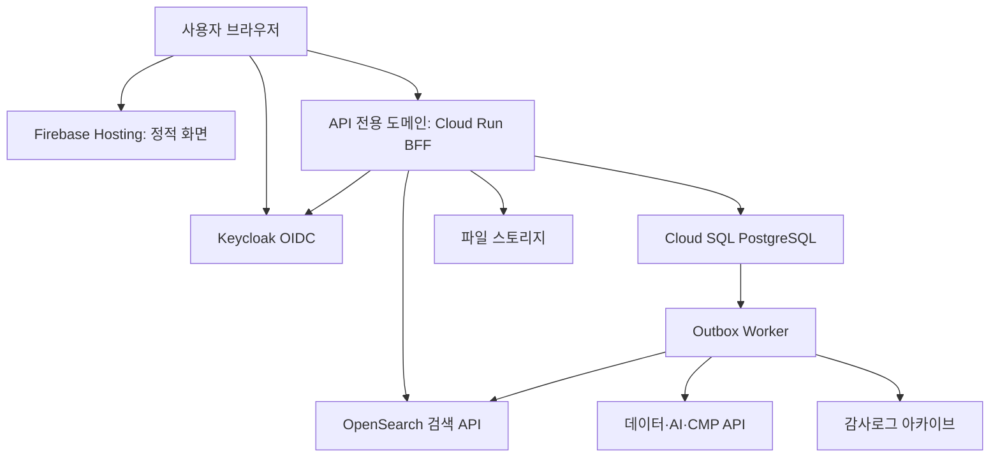

# 국방지능형플랫폼 포털 — 운영 전환 검토 및 설정 가이드

작성: 2026-09-15 · 대상: `KBitone-Company/kt-ai-portal` / `backstage-portal/`

이 문서는 첨부 소스 ZIP과 인수인계 문서, 기존 화면 캡처를 검토하여 작성했습니다. 실제 Firebase 계정·운영 OpenSearch·플랫폼 API에 접속한 결과는 아닙니다. **이번 산출물은 구현 지시서이며 DB 구축·배포·실연동 시험을 완료했다는 의미가 아닙니다.**

## 1. 판단과 추진 방향

기존 화면과 업무 정의는 활용할 가치가 큽니다. 그러나 실제 운영을 위해서는 **포털 고유 업무 API, PostgreSQL 저장, 서버 인가, 테넌트 격리, 감사 원장, 실제 검색·플랫폼 연계**를 구현해야 합니다. DB 접속 문자열만 바꾸거나 화면을 꾸미는 것으로 해결되지 않습니다.

| 구분 | 적용 결정 |
|---|---|
| 기존 자산 | Backstage·React·TypeScript 모노레포와 기존 업무기능 유지, 점진 개선 |
| 운영 모델 | 첨부 인프라 문서의 폐쇄망·VM 설치를 최종 기준으로 가정. Firebase/Google Cloud는 합성데이터 기반 통합 검증 환경 |
| DB | 같은 Google Cloud 프로젝트의 Cloud SQL for PostgreSQL 16, 현재 지원되는 보안 패치 버전. 폐쇄망은 동일 스키마의 PostgreSQL |
| 서버 | Backstage custom backend plugin/BFF + 별도 실행 가능한 worker. 과도한 마이크로서비스 분해 없이 도메인 모듈 분리 |
| 인증 | 최종 운영은 Keycloak OIDC. 기존 Firebase 로그인은 서버 검증을 갖춘 개발 어댑터로만 허용하며 OIDC 통합시험 별도 수행 |
| API Gateway | 폐쇄망 표준 배포에 Kong Gateway DB-less 구성을 포함. 라우팅·제한·공통 관제 담당, 업무 인가의 최종 책임은 BFF |
| 검색 | OpenSearch 3노드, 서버 인가 검색 API, 실제 색인·삭제·권한변경 동기화 |
| 로그 | PostgreSQL 감사 원장 + transactional outbox + 중앙 검색용 로그 + 보존용 불변 아카이브 |
| 개인화 | 테넌트 브랜드·메뉴·기본 홈과 사용자별 화면 설정을 분리 저장 |
| 검증 | 실제 PostgreSQL·OpenSearch·OIDC를 사용하는 통합시험, 권한 거부시험, 재시작·장애·복구시험 |

확정되지 않은 사항은 ‘최종 운영망, 3중화 대상 및 물리 장애 도메인, 실제 플랫폼 API, K-RMF 적용 기준’입니다. 이 문서의 가정으로 개발을 진행할 수 있지만 최종 운영 승인 조건에는 남겨야 합니다. 무응답을 확정 승인으로 간주하지 않습니다.

## 2. 소스에서 확인한 우선 보완사항

아래 경로는 저장소 루트 기준이며 줄번호는 첨부본 기준입니다. 표에서 `components/` 또는 컴포넌트 파일명만 쓴 경우 `backstage-portal/packages/app/src/components/` 아래 파일입니다.

| 우선 | 확인 내용 | 근거 | 보완 |
|---|---|---|---|
| P0 | 배포 환경에서 검색 API를 생략하고 샘플 결과 반환 | `backstage-portal/packages/app/src/components/integrated-search/IntegratedSearchPage.tsx` 83–98 | hostname 분기·운영 mock fallback 제거, 실제 검색 API 연결 |
| P0 | 캡처 모드를 꺼도 sessionStorage 관리자 미리보기가 UI 관리자 권한에 영향 | `components/authz/AuthzContext.tsx` 69–87 | 서버 검증 신원·권한으로 교체, 브라우저 권한 승격 제거 |
| P0 | Backstage backend 권한 정책이 allow-all | `backstage-portal/packages/backend/src/index.ts` 42–47 | 기본 거부 정책 및 각 업무 API 객체 인가 |
| P0 | OpenSearch raw proxy가 무인증 허용 | `backstage-portal/app-config.yaml` 62–71 | raw proxy 제거, 검증된 검색 조건만 받는 BFF 구현 |
| P0 | 포털 업무 migrations·repository·API가 없음 | backend `src/index.ts`, `app-config.production.yaml` | PG 업무 스키마와 쓰기 트랜잭션 구현. 기본 Backstage 플러그인 서버는 존재 |
| P0 | 감사·승인 이력이 mock 또는 화면 state | `AdminConsolePage.tsx`, `ExportApprovalPage.tsx` | 검증된 행위자와 서버시간으로 원장 저장 |
| P0 | OpenSearch가 single-node, 보안 플러그인 해제, replica 0 | `infra/opensearch/docker-compose.yml`, `scripts/01-create-index.sh` | TLS·인증·3노드·복제·백업·복구시험 |
| P1 | 메뉴 활성/숨김/저장 기능 비활성, 테넌트 설정은 샘플 | `MenuDetailPanel.tsx`, `TenantManagementPage.tsx` | 실제 편집·게시·버전·롤백, 서버 저장 |
| P1 | 검색 필터·추천·집계가 mock/클라이언트 필터에 의존 | `SearchApiClient.ts`, `searchFiltering.ts` | 테넌트·프로젝트·보안등급을 서버에서 검색 전 적용 |
| P1 | K-RMF 증빙 집계가 목록과 불일치 | `krmf-evidence/mockKrmfEvidence.ts` 관련 fixture | 집계 상수 제거, 관계 데이터로 계산, 정합성 시험 |
| P1 | 실제 연계 후보를 화면에 표현한 단계 | `mockPlatformApiIntegrationData.ts` | 후보 계약과 검증된 API 구분, adapter·계약시험·실연동시험 |
| P2 | 표가 눌려 이메일·날짜가 과도하게 줄바꿈 | `docs/assets/design-stage33-2/after/admin-1366.png` | 넓은 목록 + 상세 drawer/전용 화면, 열 선택·밀도 설정 |

인수인계의 Node 20/24 설명과 실제 `package.json`의 `22 || 24`, Backstage `1.52.0`, Yarn `4.13.0`이 다릅니다. Kimi는 현재 lockfile·소스·공식 호환표를 먼저 확인하고 지원되는 런타임을 고정해야 합니다. 기존 테스트 통과 기록도 이번 실행 결과로 재사용하면 안 됩니다.

첨부본에는 원본 RFP PDF가 없습니다. SFR-001~021 대응표는 요구사항 추적의 시작점으로 활용하고 원본 확인 전 ‘RFP 완전 충족’을 선언하지 않습니다.

## 3. Firebase에서 PostgreSQL을 적용하는 방법

Firebase의 관계형 DB 제품은 현재 **Firebase SQL Connect(구 Data Connect)**이며, Cloud SQL for PostgreSQL을 기반으로 합니다. [Firebase 공식 설명](https://firebase.google.com/docs/sql-connect), [명칭 변경 안내](https://firebase.blog/posts/2026/04/whats-new-sql-connect/)

이 프로젝트에서는 이미 Backstage 서버와 OIDC 연계, 승인 트랜잭션, 감사로그, 폐쇄망 이관 요구가 있으므로 **Firebase Hosting + Cloud Run + Cloud SQL 직접 연결**을 채택합니다. SQL Connect는 이번 기본 구성의 필수 요소가 아닙니다. 두 계층이 같은 업무 테이블의 스키마와 쓰기 권한을 따로 관리하지 않게 합니다. 이 선택은 위 요구를 고려한 설계 판단입니다.



브라우저의 SQL 직접 연결과 원천 플랫폼의 관리자 토큰 전달은 금지합니다. Cloud Run은 VPC 연결을 통해 DB·검색에 접근하고 서비스 계정과 Secret Manager를 사용합니다. [Cloud Run–Cloud SQL 연결](https://docs.cloud.google.com/sql/docs/postgres/connect-run)

### Firebase Hosting rewrite에서 특히 주의할 점

기존 `/api/** → Cloud Run` rewrite는 일반 API에 활용할 수 있지만, Hosting은 전달 쿠키에 제약이 있고 `__session` 쿠키만 특별 취급합니다. 기존 Backstage/OIDC 세션 쿠키가 그대로 동작한다고 가정하면 안 됩니다. 따라서 **API와 OIDC callback은 별도 API origin으로 직접 연결하는 구성을 기본안**으로 하고, 가능하면 `portal.example.com`과 `api.example.com`처럼 같은 상위 도메인을 사용합니다. `web.app`과 `run.app` 조합은 브라우저의 cross-site 쿠키 제한도 확인해야 합니다. 허용 origin·CORS·쿠키·CSRF·리다이렉트 URI를 실제 브라우저에서 검증합니다. 사용자 API 응답은 서버에서 `Cache-Control: private, no-store`로 설정합니다. [Hosting 쿠키·캐시 설명](https://firebase.google.com/docs/hosting/manage-cache)

Hosting의 동적 요청에는 60초 제한이 있으므로 긴 프로비저닝·대용량 반출·색인 작업은 요청 하나에 매달지 않습니다. API는 `202 + operationId`를 반환하고 worker가 처리하며 상태조회로 진행을 표시합니다. [Hosting–Cloud Run 제한](https://firebase.google.com/docs/hosting/cloud-run)

## 4. Q님이 준비할 항목 — 순서대로

기존 프로젝트 ID는 **`kai-platform-d0ae0`**입니다. `kqa-hub`, `k-ucap` 등 다른 프로젝트와 혼용하지 않습니다. 아래 신규 자원명은 제안값이며 이미 존재한다고 가정하지 않습니다.

| 순서 | Q님 설정/제공 | 구체 내용 | Kimi 수행 |
|---|---|---|---|
| 1 | 프로젝트·과금 확인 | Firebase/Google Cloud에서 `kai-platform-d0ae0` 선택, Billing/Blaze 및 예산 알림 확인. 예산 알림은 지출 상한이 아님 | 현재 자원 읽기 목록, 배포 대상과 월비용 구성 항목 문서화 |
| 2 | 개발자 권한 | 개인 계정 로그인 또는 조직의 짧은 수명 자격증명 사용. 런타임에 Owner/Editor 부여 금지 | 필요한 API/IAM 권한만 적은 스크립트·계획 생성 |
| 3 | 서비스 API 활성화 | Cloud SQL Admin, Cloud Run, Secret Manager, Artifact Registry, Cloud Build. VPC 방식에 따라 Compute/Service Networking. 실제 필요한 것만 | 사용 여부 확인, 재실행 가능한 설정 스크립트 |
| 4 | Cloud SQL 생성 | PostgreSQL 16 최신 지원 minor, 리전 `asia-northeast3`. 제안명 `kai-portal-pg-staging`. UTF-8, 자동백업·PITR·삭제보호. 개발 초기 단일존 가능, HA 시험 환경은 Regional | 버전·연결 검증, DB·역할·스키마 migrations |
| 5 | DB 네트워크 | Private IP 우선. VPC/서브넷과 Private Service Access 또는 선택한 지원 연결 방식 준비. `0.0.0.0/0` 허용 금지 | Cloud Run Direct VPC egress 또는 connector 연결, TLS/Cloud SQL connector 시험 |
| 6 | DB 연결값 전달 | 인스턴스 연결명 `project:region:instance`, private host 또는 connector 방식. 비밀번호는 Secret Manager 참조로 전달 | `portal_business`, Backstage용 DB/스키마, Keycloak DB를 분리하고 `portal_migrator`·`portal_runtime` 권한 분리 |
| 7 | 서비스 계정 | 예: `kai-portal-runtime`, migration 전용, worker 전용. DB·버킷·Secret별 최소권한 | Cloud SQL Client, 필요한 Secret Accessor 등 정확한 바인딩, 키 파일 없는 실행 |
| 8 | 로그인 환경 | 최종 Keycloak URL·realm·client·redirect URI·인증서. localhost는 local-integration에만 사용. GCP staging은 브라우저와 Cloud Run 양쪽에서 같은 HTTPS issuer·DNS·CA와 discovery/token/JWKS 경로에 접근 가능해야 함. 기존 Firebase Auth 사용 여부 확인 | Keycloak 구성 샘플과 실 OIDC 로그인, 역할·그룹·탈퇴/잠금 처리. 임시 Firebase 경로도 서버 ID 검증 필수 |
| 9 | 최초 관리자 | 최초 관리자 1명의 검증된 issuer+subject 또는 Firebase UID를 안전한 설정 경로로 전달 | 반복 가능한 bootstrap. 처음 가입한 사람에게 자동 관리자 권한 부여 금지 |
| 10 | 파일 버킷 | 검역·허용된 파일·감사 아카이브의 접근권한 분리. GCS 버킷명은 전역에서 유일한 사용 가능 이름 선택 | metadata·검사·해시·버전·다운로드 인가. 보존 잠금은 확정 보존정책 이후 적용 |
| 11 | OpenSearch | 3개 VM/장애 도메인·내부주소·CA·계정 제공 또는 설치용 VM 준비. Cloud Run 안에 영구 검색노드 설치 금지 | TLS/3노드 구성·색인·ACL·snapshot·장애시험 자동화 |
| 12 | 원천 플랫폼 자료 | 데이터/AI/CMP/OpenMetadata/스토리지/보안 시스템의 OpenAPI·버전·오류형식·callback·테스트 계정·네트워크 경로 | API 계약 정리, adapter, 실제 sandbox 시험. 명세가 없으면 독립 계약 시험 서버까지 구현 |
| 13 | 운영 정책 | 테넌트 명칭·조직·관리자, 사용자수, 보안분류, K-RMF 기준판, 로그/파일 보존기간, RPO/RTO, 반출 승인선 | 설정파일·초기 데이터·수용시험에 반영. 미확정 정책은 운영 게이트로 표시 |
| 14 | staging 배포 대상 | 기존 demo와 구분되는 API 서비스·Hosting preview/channel·도메인 결정 | 변경계획·migration·백업·rollback을 먼저 제시하고 승인된 환경에 배포 |

공개 클라우드 검증에는 합성데이터를 사용합니다. 첨부 문서가 전제하는 국방 폐쇄망 데이터의 외부 반출 권한은 이번 요청에 포함되어 있지 않습니다.

### 설정값 전달 양식

시크릿 값은 채팅이나 Git에 붙이지 말고 아래 `*_SECRET_REF`의 참조 또는 승인된 로컬 환경파일로 전달합니다. Firebase 웹 설정값은 서버 비밀키와 구별하며, 값이 공개되어도 인증·인가가 성립해야 합니다.

```dotenv
# Kimi가 실제 config schema에 매핑할 설계 변수. 아직 실행 완료된 설정 아님.
PORTAL_ENV=staging
GOOGLE_CLOUD_PROJECT=kai-platform-d0ae0
GOOGLE_CLOUD_REGION=asia-northeast3
APP_BASE_URL=<staging UI origin>
BACKEND_BASE_URL=<API origin>
AUTH_PROVIDER=oidc
OIDC_ISSUER_URL=<https://idp-host/realms/kt-ai>
OIDC_CLIENT_ID=<approved client>
OIDC_CLIENT_SECRET_REF=<Secret Manager resource>
INITIAL_ADMIN_SUBJECT=<verified subject; not email-only>
SQL_INSTANCE_CONNECTION_NAME=<project:region:instance>
POSTGRES_HOST=<private host or connector configuration>
POSTGRES_PORT=5432
PORTAL_DATABASE=portal_business
POSTGRES_USER=portal_runtime
POSTGRES_PASSWORD_SECRET_REF=<Secret Manager resource>
OPENSEARCH_NODE_URLS=<three private HTTPS endpoints>
OPENSEARCH_CA_SECRET_REF=<CA resource>
OPENSEARCH_SEARCH_CREDENTIAL_SECRET_REF=<read account resource>
OPENSEARCH_INDEXER_CREDENTIAL_SECRET_REF=<write account resource>
OBJECT_STORAGE_PROVIDER=gcs
QUARANTINE_BUCKET=<bucket>
EVIDENCE_BUCKET=<bucket>
AUDIT_ARCHIVE_BUCKET=<bucket>
DATA_PLATFORM_BASE_URL=<approved endpoint>
AI_PLATFORM_BASE_URL=<approved endpoint>
CMP_BASE_URL=<approved endpoint>
OPENMETADATA_BASE_URL=<approved endpoint>
ALLOW_SAMPLE_DATA=false
```

전체 Secret Manager 값을 운영자 화면에서 다시 보여주지 않습니다. 기존 `.env.example`·`config.d.ts`·Backstage visibility 설정을 함께 갱신하여 비밀이 frontend bundle에 포함되지 않게 합니다.

## 5. 3중화의 정확한 구성

**3개 프로세스가 한 서버에 있는 것은 단일 서버 장애 대비 3중화가 아닙니다.** VM anti-affinity, 물리호스트·전원·스토리지·네트워크 장애 도메인을 같이 확인합니다. 아래는 핵심 서비스에 한 개 장애 도메인 상실을 견디는 구성의 설계안입니다.

| 계층 | 최종 내부망 기준 | 검증해야 할 내용 |
|---|---|---|
| L4/VIP | 기존 이중화 L4 또는 HAProxy+Keepalived 2대 이상 | VIP·상위망 단일 장애점 제거. GCP에 VRRP를 그대로 이식하지 않음 |
| WEB | 정적서버 3개, 분산 배치 | 한 노드 제외 시 화면 서비스 지속 |
| Kong | DB-less 3개 | 동일 선언형 설정 버전·체크섬, 3개 노드에 별도 배포, 관리 API 비공개 |
| BFF/WAS | 3개, 무상태 | 공유 세션/검증 상태, cache 무효화, 중복 요청 방지, graceful shutdown |
| Worker | 3개 실행 가능, DB lease/claim으로 작업 분산 | 동시에 같은 프로비저닝·메일·색인·과금 작업을 실행하지 않음 |
| PostgreSQL | Primary 1 + Standby 2, Patroni + etcd 3 voting members | 단일 쓰기자, 동기복제 정책, leader election, fencing, split-brain 방지 |
| Keycloak | 3개 + HA DB | 지원 버전의 클러스터 discovery/cache/session 구성과 재로그인·세션 회수 검증 |
| OpenSearch | 3개 cluster-manager eligible + data 노드, 도메인 분산 | 2/3 정족수. 작은 초기 구성은 역할 겸용, 규모 증가 시 manager 3 + 별도 data 노드 |
| 파일 | 기존 승인된 HA S3/NAS 또는 검증된 분산 오브젝트 스토리지 | 노드 수뿐 아니라 디스크/EC set/읽기·쓰기 quorum과 전체 노드 상실 조건을 계산 |
| 감사 수집 | 복수 수집 경로 + 내구성 있는 backlog + 별도 보존 원본 | 수집기 장애 중 손실 0 목표, 복구 후 재전송·중복 제거 |

PostgreSQL은 **3대 active-active 동시 쓰기**를 기본으로 하지 않습니다. 동기 standby 1대를 요구하는 정책과 장애 시 승격 가능 노드를 명확히 하고, 동기 복제 대상이 없을 때 쓰기를 차단할지 정합니다. 권고 기본은 중요 트랜잭션에서 무손실을 우선하는 strict 동기 정책이며 가용성 저하도 시험합니다. 두 노드 동시 상실까지 무손실·지속 서비스를 보장한다고 표현하지 않습니다. [Patroni 복제 모드](https://patroni.readthedocs.io/en/latest/replication_modes.html)

Cloud SQL의 Regional HA는 **primary+standby**입니다. 읽기 replica를 추가할 수 있지만 그 구성을 동일한 자동 장애조치 3노드나 3중 쓰기라고 부르면 안 됩니다. 클라우드 HA 시험과 내부망 Patroni 3노드 시험은 별도입니다. Cloud Run의 `min-instances=3`도 사용자가 지정한 물리 3대/3개 존 배치를 보장하는 구성과 다릅니다. [Cloud SQL HA](https://docs.cloud.google.com/sql/docs/postgres/high-availability)

OpenSearch에서 3개의 문서 사본까지 원하면 `number_of_replicas=2`입니다. `1`이면 primary+replica의 총 2사본입니다. 3노드·2 replicas에서 한 노드가 내려가면 남은 2노드로 검색이 지속되더라도 보통 yellow가 됩니다. 복귀 후 green을 확인해야 하며 장애 중 green을 강제 합격조건으로 두지 않습니다. 저장량은 원문 크기 외 색인 오버헤드·복제·재배치 여유를 계산합니다. [클러스터·할당 설계](https://docs.opensearch.org/latest/tuning-your-cluster/)

기존 문서의 MinIO 2노드를 그대로 운영 가용성 설계로 승인하지 않습니다. 선택 버전의 라이선스·지원 방식·디스크 수·EC quorum·복구 시험을 확인한 뒤 결정하고, 초기에는 기관의 검증된 스토리지 연계를 우선 검토합니다.

## 6. Kong 적용 범위

Kong은 `사용자/WEB → Kong → BFF` 경계에 두고, 원천 플랫폼 연계는 BFF의 명시적 adapter를 통해 호출합니다. 플랫폼 API를 추가로 gateway에 수용할 때는 서비스별 route와 인증·계약·방화벽 정책을 별도로 정의합니다.

| Kong 수행 | BFF·업무 서비스 수행 |
|---|---|
| TLS 경계, route, body size, 요청시간 제한, request ID, 서비스별 상태·관측 | 사용자 신원 검증, 테넌트·프로젝트·보안등급 인가, 승인 상태전이, 감사 트랜잭션 |
| 노드별 rate limit 및 필요 시 공유 한도 저장소 | 사용자·테넌트 기준 정책과 과금/쿼터의 원자적 검사 |
| 승인된 upstream allowlist | 임의 endpoint/헤더를 신뢰하지 않는 connector |

DB-less 노드는 설정을 자동 공유하지 않으므로 선언형 파일을 모든 노드에 배포하고 일치 여부를 검사합니다. 노드별 제한을 전체 클러스터 한도로 오해하지 않습니다. [Kong DB-less 제한](https://developer.konghq.com/gateway/db-less-mode/)

공식 OIDC 플러그인은 Enterprise 전용이므로 무료 구성에서 사용할 수 있다고 가정하지 않습니다. 기본안은 **Kong의 확인된 무료 기능 + Backstage/BFF의 Keycloak 인증**입니다. 추가 제품 구매나 비공식 인증 플러그인 도입을 전제로 하지 않습니다. [Kong OIDC 플러그인](https://developer.konghq.com/plugins/openid-connect/)

## 7. 화면 개선 방향

FabriX의 AI 자산 탐색·공유·업무공간 분리에서 정보구조를 참고했습니다. 그 제품의 브랜드나 화면을 복제하거나 포털에 새로운 LLM 실행 기능을 무리하게 추가하지 않습니다. [Samsung SDS FabriX](https://www.samsungsds.com/en/ai-fabrix/fabrix.html)

| 영역 | 적용안 |
|---|---|
| 상단 | 현재 테넌트·프로젝트, 전역검색, 내 할 일, 알림, 사용자 메뉴 |
| 왼쪽 메뉴 | 펼침 256px / 축소 72px / 숨김 0px. 숨겨도 상단 복구 버튼 유지, 모바일 overlay |
| 홈 | 개인별 작업 이어가기·승인 대기·최근 자산 중심. 전체 플랫폼 통계는 권한별 보조 영역 |
| 테넌트 관리 | 로고·강조색·메뉴·홈 템플릿의 초안/미리보기/게시/롤백 |
| 개인 설정 | 즐겨찾기, 위젯 배치, 시작페이지, 표 열·밀도·저장필터, sidebar 상태 |
| 관리자 | 사용자/권한, 테넌트/메뉴, 정책/세션, 연계/운영, 감사/보안으로 묶고 가로 탭 과밀 해소 |
| 데이터 표현 | 원천 플랫폼, 기준시각, 조회 범위, 동기화 상태. 실패·미연결을 0/정상으로 표시하지 않음 |
| TX | 신청 접수·승인·원천 처리·완료를 분리, 재시도·진행 확인·실패 복구 제공 |

테넌트 메뉴에서 숨기는 것과 API 접근권한을 회수하는 것은 서로 다른 정책입니다. 사용자 개인화는 서버가 허용한 범위에서만 동작하고 테넌트 전환 시 이전 데이터·검색추천·캐시가 섞이지 않게 해야 합니다.

## 8. 전달 자료와 사용법

1. `KAIPotal_Kimi_Development_Prompt.md`: Kimi가 읽고 실행할 본 지시문입니다.
2. `KAIPotal_Implementation_Test_Spec.md`: DB·API·감사·검색·테스트 계약입니다. 본 지시문과 함께 제공하십시오.
3. 이 문서: Q님 설정 순서, 검토 근거, 설계 전제입니다.

세 문서를 저장소의 `docs/production-upgrade/`에 넣은 후 다음 요청으로 시작하시면 됩니다.

> `docs/production-upgrade/`의 세 문서를 읽고 `KAIPotal_Kimi_Development_Prompt.md`를 실행하세요. 먼저 현재 저장소와 환경을 확인하고 P0부터 구현·시험하세요. 기능/보안/DB/로그를 모두 실제 서버 동작으로 연결하고, 미연결 원천 플랫폼은 실연동 완료로 표시하지 마세요. 완료 시 CHANGE_SUMMARY.md를 갱신하고 지정된 kimi_done.sh 실행 결과를 기록하세요.

소스 기준 점검은 완료했습니다. 현재 작업 환경에는 Docker/Podman, gcloud/Firebase CLI, 프로젝트 의존성 설치본이 없어 실제 PostgreSQL·OpenSearch 클러스터나 배포를 실행 검증하지 못했습니다. 따라서 OpenSearch의 현재 판정은 **‘운영 구성 미비 확인 / 실제 실행·장애시험 미수행’**입니다.
